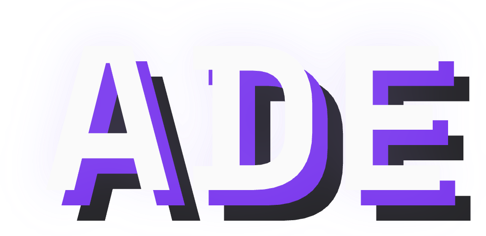
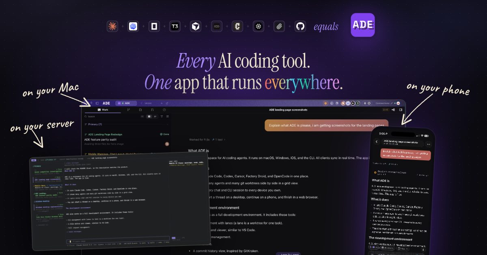
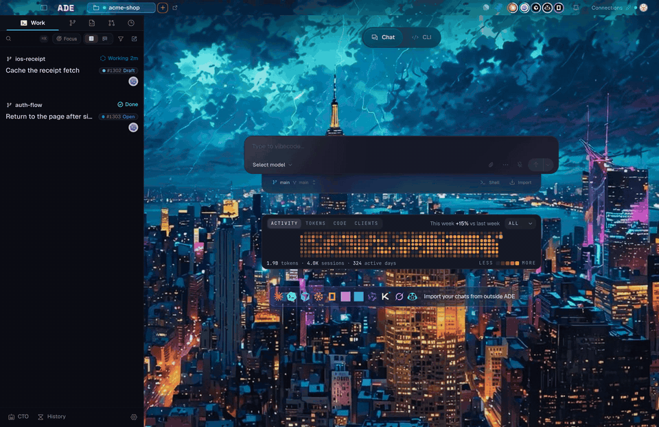
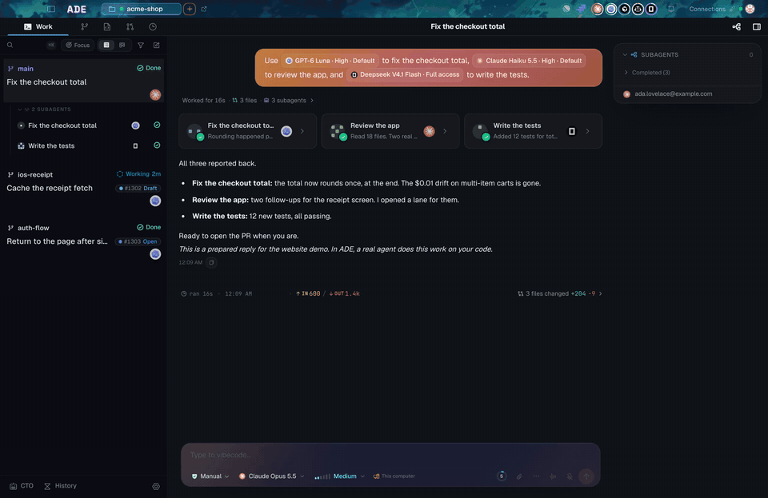
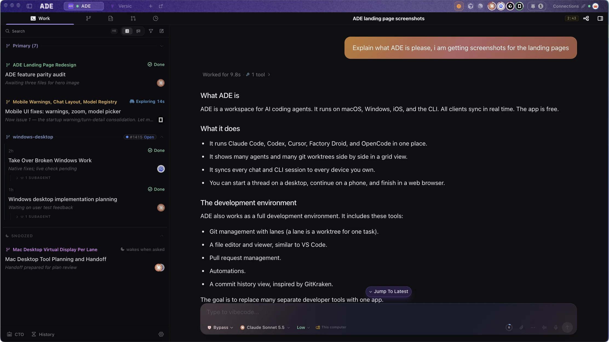
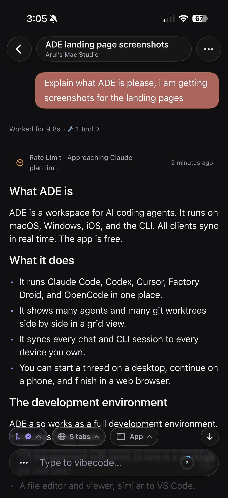

<p align="center">
  <a href="https://ade-app.dev">
    
  </a>
</p>

<p align="center">
  <strong>Every AI coding tool. One app that runs everywhere.</strong>
</p>

<p align="center">
  <a href="https://ade-app.dev/download/mac-arm64">macOS</a> ·
  <a href="https://ade-app.dev/download/windows">Windows</a> ·
  <a href="https://testflight.apple.com/join/ZSdJGKPy">iOS</a> ·
  <a href="https://app.ade-app.dev">Web</a> ·
  <a href="https://ade-app.dev/docs">Docs</a> ·
  <a href="https://www.ade-app.dev/docs/changelog">Changelog</a>
</p>

<p align="center">
  <a href="https://github.com/arul28/ADE/releases/latest"></a>
  <a href="https://github.com/arul28/ADE/actions/workflows/ci.yml"></a>
  <a href="LICENSE"></a>
  <a href="https://github.com/arul28/ADE/stargazers"></a>
</p>

<p align="center">
  
</p>

ADE puts Claude Code, Codex, Cursor, Factory Droid, and OpenCode in one app. You use the plans you already pay for.

It runs on your own machines. Sign in on each one, and you can reach all of them from the desktop app, the terminal, the web, or your phone. Every chat and terminal session stays in sync. I start a task on my desktop at home, check on it from my phone at the gym, and finish it in a browser on a friend's laptop.

It's also a full dev environment: git worktrees, a code editor, pull requests, and history. And it's free.

## What it looks like

**Pick any agent and any model.**



**Run agents together.** Here Claude hands three jobs to GPT, Claude Haiku, and DeepSeek, and they report back.


**Use every machine you own.** One chat checks the same branch on a Mac Studio and a Windows PC.



**Same work, any screen.** Desktop and phone show the same chat.

<table>
<tr>
<td width="88%"></td>
<td width="12%"></td>
</tr>
</table>

## Get started

**1. Install it.** This installs ADE's background service (the "Brain") and the `ade` command. It also asks whether you want the desktop app.

```bash
# macOS and Linux
curl -fsSL https://ade-app.dev/install.sh | sh
```

```powershell
# Windows
irm https://ade-app.dev/install.ps1 | iex
```

Or download the desktop app for [Apple Silicon](https://ade-app.dev/download/mac-arm64), [Intel](https://ade-app.dev/download/mac-x64), or [Windows](https://ade-app.dev/download/windows). It includes the Brain. On Homebrew: `brew install --cask arul28/ade/ade`.

**2. Sign in.** The installer asks you to. If you skipped it, run:

```bash
ade connect
```

Your account is what links your machines. Run `ade connect` on each one you want to reach: your laptop, a desktop at home, a Linux server. A machine with no browser shows a QR code; scan it with your phone and sign in there.

You can skip the account. ADE still works on that one machine, but you can't reach it from anywhere else.

**3. Open a client.** Open the desktop app, go to [app.ade-app.dev](https://app.ade-app.dev), or get the [iOS app](https://testflight.apple.com/join/ZSdJGKPy). Your machines are already there.

**4. Open a repo and go.** Open a git repository, make a lane (a git worktree for one task), and ask for a small change. The [quickstart](https://www.ade-app.dev/docs/quickstart) walks through it.

## Set up your models

Go to **Settings → AI Providers**.

- **Use a subscription you already have.** Sign in to Claude, ChatGPT, Cursor, or Factory. If you're already signed in to that tool's own CLI, ADE uses it.
- **Or paste an API key.** Anthropic, OpenAI, Google, DeepSeek, xAI, Mistral, Groq, OpenRouter, and others. OpenCode reaches 160+ more.
- **Click Verify, then pick a default model.** You can switch models in any chat.
- **Mix them.** Under **Advanced**, add any OpenAI- or Anthropic-compatible provider, so you can run, say, DeepSeek inside Claude Code.

You don't need to install the agents. ADE downloads them the first time a machine needs one. Model calls go straight from your machine to the provider, not through ADE.

More: [AI providers](https://www.ade-app.dev/docs/configuration/ai-providers).

## Where it runs

| | |
| --- | --- |
| Desktop app | macOS 13+, Windows 10/11 x64 |
| `ade` CLI | macOS, Linux, Windows |
| Web | Any browser, at [app.ade-app.dev](https://app.ade-app.dev) |
| Phone | iOS on [TestFlight](https://testflight.apple.com/join/ZSdJGKPy). App Store and Android coming soon. |
| Brain only | Linux (x64, arm64), plus everything above |

There's no Linux desktop app yet, but a Linux machine can run the Brain and you can use it from any client. A few Mac features aren't on Windows yet ([details](https://www.ade-app.dev/docs/getting-started/windows)).

## Handy commands

```bash
ade connect --status --text   # check this machine's connection
ade machines list --text      # list the machines on your account
ade doctor                    # find a problem
ade help <command>            # help for any command
```

Everything else: [CLI reference](apps/ade-cli/README.md) · [install options](https://www.ade-app.dev/docs/getting-started/install) · [connecting machines](https://www.ade-app.dev/docs/getting-started/connect-machine).

## Work on ADE

```bash
npm run setup   # first time
npm run dev     # build the CLI and open a dev copy of the desktop app
```

The dev copy uses its own profile and its own Brain, so it won't touch the ADE you have installed.

```text
apps/ade-cli   the Brain and the ade command
apps/desktop   the desktop app (Electron)
apps/ios       the iPhone app (SwiftUI)
apps/web       ade-app.dev
docs/          product and engineering docs
```

Before you open a PR, run `npm --prefix apps/desktop run typecheck` and the tests near what you changed. The full suite is large; CI runs all of it.

More: [local development](docs/development/local-development.md) · [architecture](docs/ARCHITECTURE.md) · [contributing](CONTRIBUTING.md).

## License

[AGPL-3.0](LICENSE). © 2025 Arul Sharma. Free forever.

`@ade-dev/sdk` and `@ade-dev/chat-ui` on npm are MIT. Shipping an unmodified ADE runtime inside a larger work is covered by the [runtime embedding exception](RUNTIME-EMBEDDING-EXCEPTION.md).
