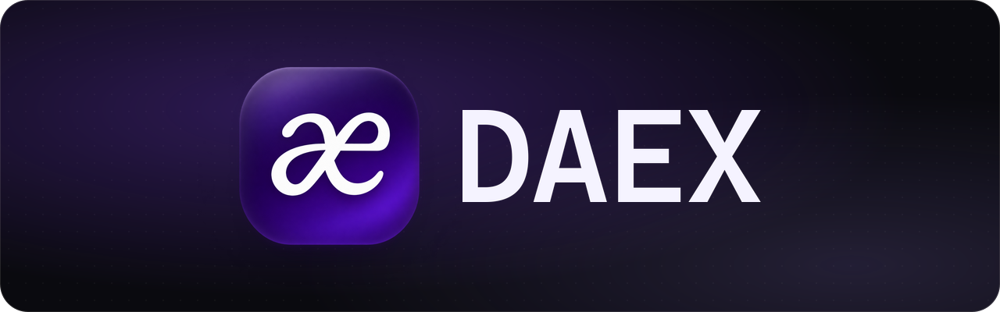
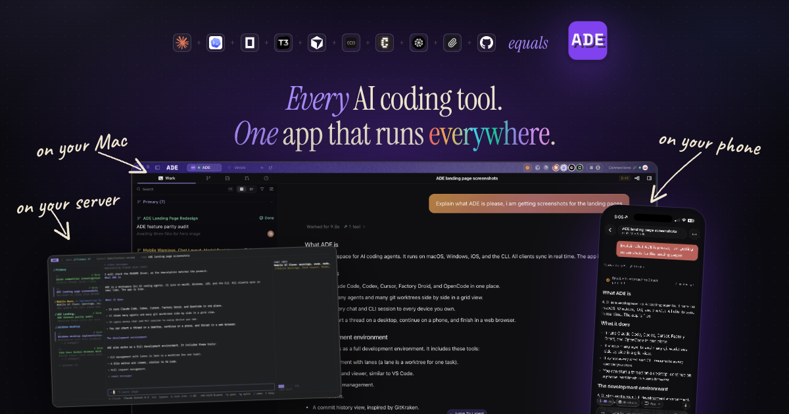
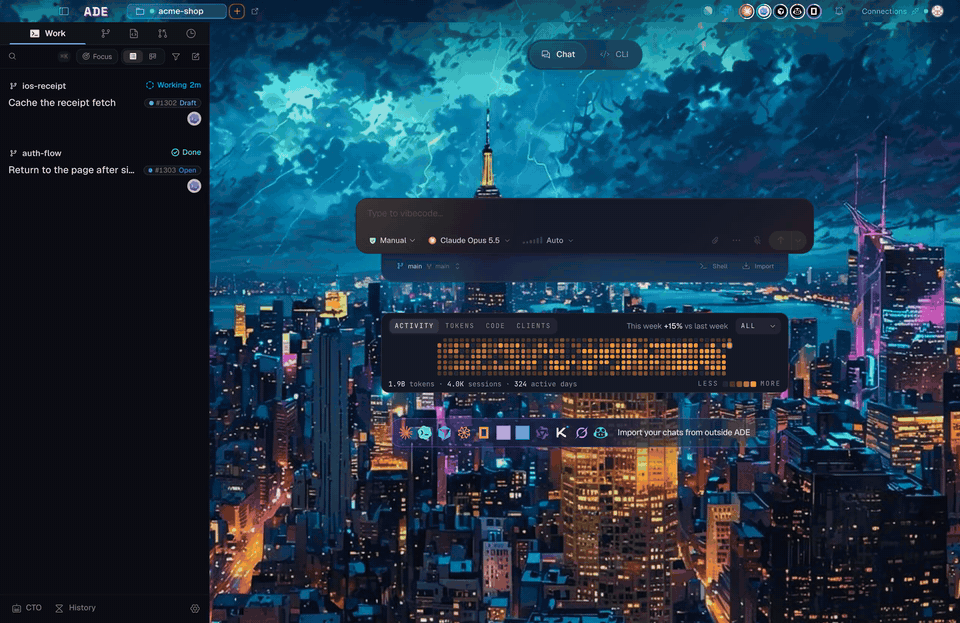
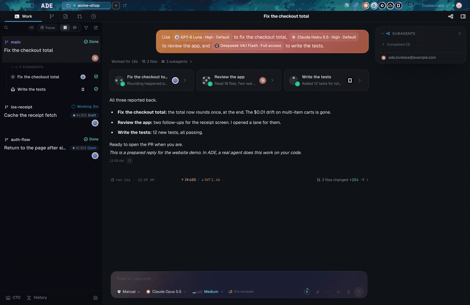
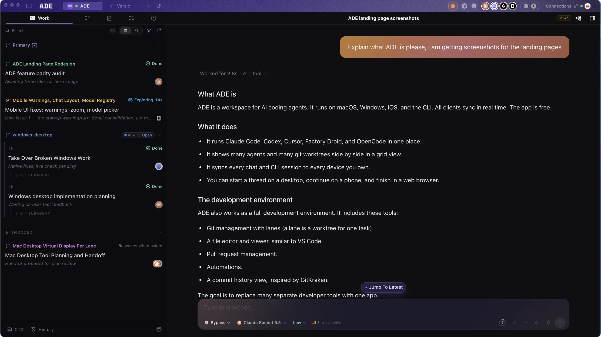
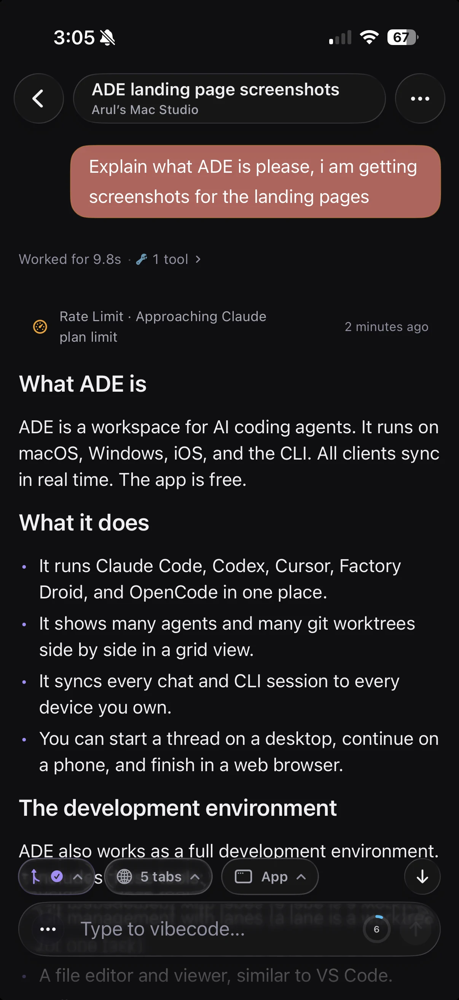

<p align="center">
  <a href="https://ade-app.dev">
    
  </a>
</p>

<p align="center">
  <strong>Every AI coding tool. One app that runs everywhere.</strong>
</p>

<p align="center">
  <a href="https://ade-app.dev/download/mac-arm64">macOS</a> ·
  <a href="https://ade-app.dev/download/windows">Windows</a> ·
  <a href="https://ade-app.dev/docs/getting-started/linux">Linux</a> ·
  <a href="https://testflight.apple.com/join/ZSdJGKPy">iOS</a> ·
  <a href="#daex-beta">Beta</a> ·
  <a href="https://app.ade-app.dev">Web</a> ·
  <a href="https://ade-app.dev/docs">Docs</a> ·
  <a href="https://ade-app.dev/docs/changelog">Changelog</a>
</p>

<p align="center">
  <a href="https://github.com/arul28/ADE/releases/latest"></a>
  <a href="https://github.com/arul28/ADE/actions/workflows/ci.yml"></a>
  <a href="LICENSE"></a>
  <a href="https://github.com/arul28/ADE/stargazers"></a>
</p>

<p align="center">
  
</p>

Daex (formerly ADE) puts Claude Code, Codex, Cursor, Factory Droid, and OpenCode in one app. You use the plans you already pay for.

You don't need a computer of your own. Every Daex account has **Daex Cloud**, a machine that is always there, in every "Run on" menu on the web, the iPhone and the desktop. Sign in at [app.ade-app.dev](https://app.ade-app.dev) or on your phone, connect GitHub, pick a repo, and work. Each cloud lane gets its own computer that sleeps when idle and wakes when you send it work.

Your own machines sit next to Daex Cloud. Sign in on each one, and you can reach all of them from the desktop app, the terminal, the web, or your phone. Every chat and terminal session stays in sync. I start a task on my desktop at home, check on it from my phone at the gym, and finish it in a browser on a friend's laptop.

It's also a full dev environment: git worktrees, a code editor, pull requests, and history. And it's free.

## What it looks like

**Pick any agent and any model.**


**Run agents together.** Here Claude hands three jobs to GPT, Claude Haiku, and DeepSeek, and they report back.



**Use every machine you own.** One chat checks the same branch on a Mac Studio and a Windows PC.



**Same work, any screen.** Desktop and phone show the same chat.

<table>
<tr>
<td width="88%"></td>
<td width="12%"></td>
</tr>
</table>

## Get started

**No computer?** Go to [app.ade-app.dev](https://app.ade-app.dev) or get the [iOS app](https://testflight.apple.com/join/ZSdJGKPy), sign in, and pick **Daex Cloud** under **Run on**. You can skip the rest of this section.

**1. Install it.** This installs Daex's background service (the "Brain") and the `daex` command. It also asks whether you want the desktop app.

```bash
# macOS and Linux
curl -fsSL https://ade-app.dev/install.sh | sh
```

```powershell
# Windows
irm https://ade-app.dev/install.ps1 | iex
```

Or download the desktop app for [Apple Silicon](https://ade-app.dev/download/mac-arm64), [Intel](https://ade-app.dev/download/mac-x64), [Windows](https://ade-app.dev/download/windows), or [Linux](https://ade-app.dev/docs/getting-started/linux). It includes the Brain. On Homebrew: `brew install --cask arul28/ade/ade`.

**2. Sign in.** The installer asks you to. If you skipped it, run:

```bash
daex connect
```

Your account is what links your machines. Run `daex connect` on each one you want to reach: your laptop, a desktop at home, a Linux server. A machine with no browser shows a QR code; scan it with your phone and sign in there.

You can skip the account. Daex still works on that one machine, but you can't reach it from anywhere else.

**3. Open a client.** Open the desktop app, go to [app.ade-app.dev](https://app.ade-app.dev), or get the [iOS app](https://testflight.apple.com/join/ZSdJGKPy). Your machines and Daex Cloud are already there.

**4. Open a repo and go.** Open a git repository, make a lane (a git worktree for one task), and ask for a small change. The [quickstart](https://ade-app.dev/docs/quickstart) walks through it.

## Set up your models

Go to **Settings → AI Providers**.

- **Use a subscription you already have.** Sign in to Claude, ChatGPT, Cursor, or Factory. If you're already signed in to that tool's own CLI, Daex uses it.
- **Or paste an API key.** Anthropic, OpenAI, Google, DeepSeek, xAI, Mistral, Groq, OpenRouter, and others. OpenCode reaches 160+ more.
- **Click Verify, then pick a default model.** You can switch models in any chat.
- **Mix them.** Under **Advanced**, add any OpenAI- or Anthropic-compatible provider, so you can run, say, DeepSeek inside Claude Code.

You don't need to install the agents. Daex downloads them the first time a machine needs one. Model calls go straight from the machine that runs the agent to the provider, not through Daex. Your keys, sign-ins and Passwords follow your account to every machine, Daex Cloud too.

More: [AI providers](https://ade-app.dev/docs/configuration/ai-providers).

## Where it runs

| | |
| --- | --- |
| Desktop app | macOS 13+, Windows 10/11 x64, Linux x64 and arm64 (AppImage or `.deb`) |
| `daex` CLI | macOS, Linux, Windows |
| Web | Any browser, at [app.ade-app.dev](https://app.ade-app.dev) |
| Phone | iOS on [TestFlight](https://testflight.apple.com/join/ZSdJGKPy). App Store and Android coming soon. |
| Brain only | Linux (x64, arm64), plus everything above |
| Daex Cloud | Every account. One Linux computer per cloud lane, run by Daex |

A Linux server can run just the Brain, and you can use it from any client. A few Mac features aren't on [Windows](https://ade-app.dev/docs/getting-started/windows) or [Linux](https://ade-app.dev/docs/getting-started/linux) yet.

## Daex Beta

Want the newest work first? Daex Beta is built automatically from `main`, so fixes and features reach you hours after they merge. Every stable release is a beta that already ran on real machines without new errors. Beta builds are less tested, so expect the odd rough edge.

| | |
| --- | --- |
| Desktop | **Settings › General › Update track › Beta**. Same install and data, orange icon. Switch back to Stable any time. |
| iPhone | Join [Daex Beta on TestFlight](https://testflight.apple.com/join/SsxDjqbF). A separate app with an orange icon, installed beside the normal one. |
| Web | No separate beta: [app.ade-app.dev](https://app.ade-app.dev) updates minutes after a change merges. |

More: [Daex Beta docs](https://ade-app.dev/docs/getting-started/ade-beta).

## Handy commands

```bash
daex connect --status --text   # check this machine's connection
daex machines list --text      # list the machines on your account
daex doctor                    # find a problem
daex help <command>            # help for any command
```

Everything else: [CLI reference](apps/ade-cli/README.md) · [install options](https://ade-app.dev/docs/getting-started/install) · [connecting machines](https://ade-app.dev/docs/getting-started/connect-machine).

## Work on Daex

```bash
npm run setup   # first time
npm run dev     # build the CLI and open a dev copy of the desktop app
```

The dev copy uses its own profile and its own Brain, so it won't touch the Daex you have installed.

```text
apps/ade-cli   the Brain and the daex command
apps/desktop   the desktop app (Electron)
apps/ios       the iPhone app (SwiftUI)
apps/web       ade-app.dev
docs/          product and engineering docs
```

Before you open a PR, run `npm --prefix apps/desktop run typecheck` and the tests near what you changed. The full suite is large; CI runs all of it.

More: [local development](docs/development/local-development.md) · [architecture](docs/ARCHITECTURE.md) · [contributing](CONTRIBUTING.md).

## License

[AGPL-3.0](LICENSE). © 2025 Arul Sharma. Free forever.

`@ade-dev/sdk` and `@ade-dev/chat-ui` on npm are MIT. Shipping an unmodified Daex runtime inside a larger work is covered by the [runtime embedding exception](RUNTIME-EMBEDDING-EXCEPTION.md).
