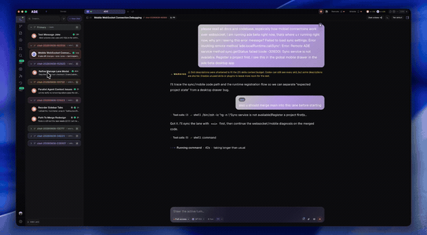
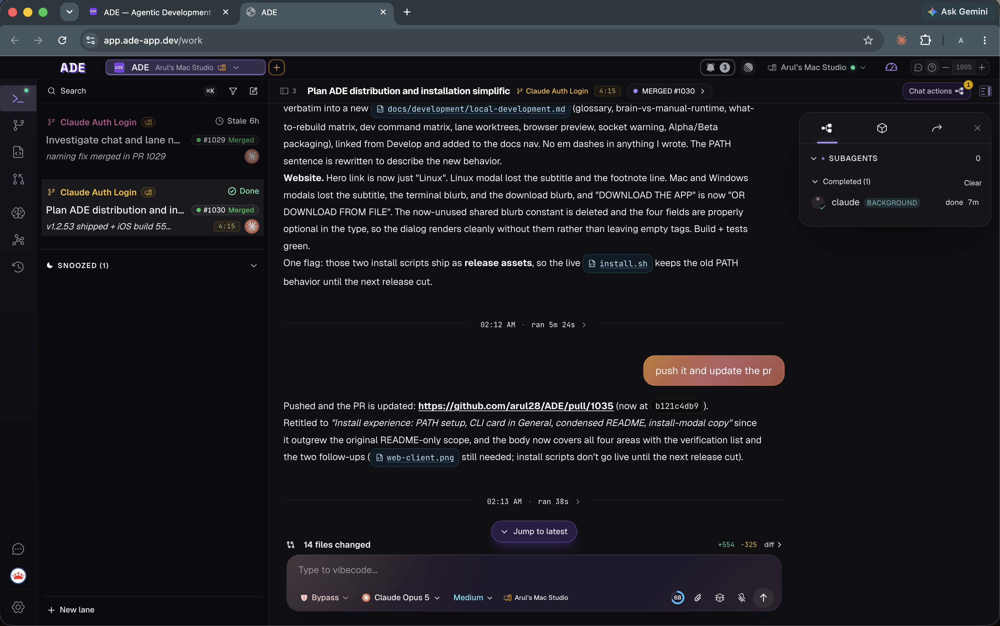
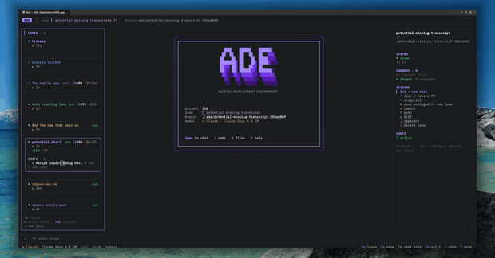
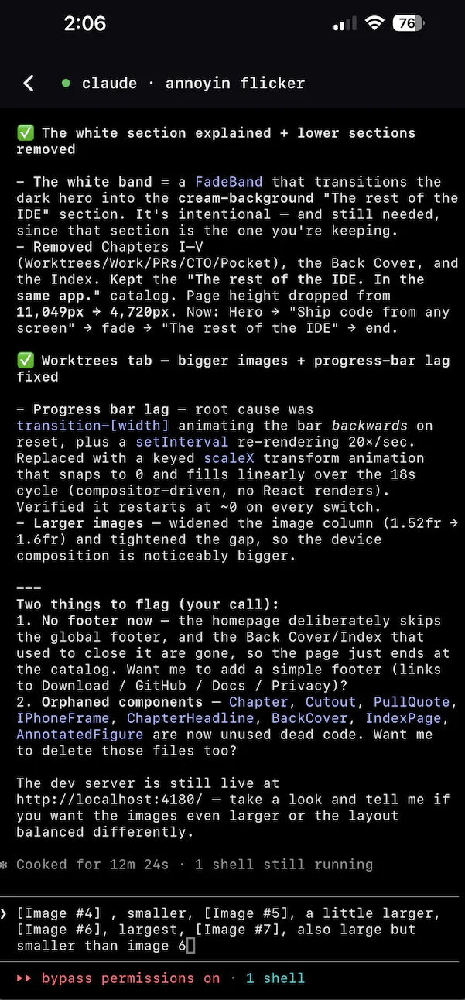
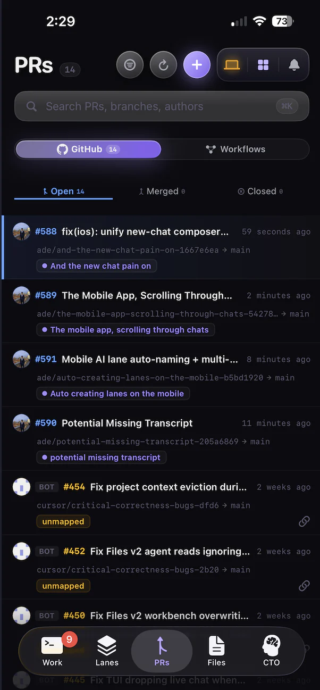

<p align="center">
  <a href="https://ade-app.dev">
    
  </a>
</p>

<p align="center">
  <strong>Every AI coding tool. One app that runs everywhere.</strong><br />
  <em>Desktop, web, terminal, and iPhone, synced in real time. Free.</em>
</p>

<p align="center">
  <a href="https://ade-app.dev/download/mac-arm64"></a>
  &nbsp;
  <a href="https://ade-app.dev/download/windows"></a>
  &nbsp;
  <a href="https://testflight.apple.com/join/ZSdJGKPy"></a>
  &nbsp;
  <a href="https://app.ade-app.dev"></a>
  &nbsp;
  <a href="https://ade-app.dev/docs"></a>
</p>

<p align="center">
  <a href="https://github.com/arul28/ADE/releases/latest"></a>
  <a href="https://github.com/arul28/ADE/actions/workflows/ci.yml"></a>
  <a href="LICENSE"></a>
  
  <a href="https://github.com/arul28/ADE/stargazers"></a>
</p>

<p align="center">
  <a href="https://ade-app.dev"></a>
</p>

ADE runs **Claude Code, Codex, Cursor, Factory Droid, and OpenCode** in one workspace, with more agents on the way. Bring the plans you already pay for.

Sign in on any machine you own, and every other ADE client can run and manage the agents on it. Every chat and every CLI session syncs to every device in real time. I start a thread on my desktop at home, pick it up on my phone at the gym, and finish it in a browser on a friend's computer.

ADE is also a full development environment: git worktrees ("lanes"), a file editor and viewer like VS Code, pull requests, automations, and a commit history view inspired by GitKraken. The goal is one app in place of a dozen dev tools.

## One workspace, four clients

<table>
<tr>
<td width="50%" valign="top">
  

**Desktop app.** The full workspace. Every agent and every worktree, tiled side by side. macOS and Windows.

</td>
<td width="50%" valign="top">
  

**Web client.** The same workspace in a browser at [app.ade-app.dev](https://app.ade-app.dev). Nothing to install.

</td>
</tr>
<tr>
<td width="50%" valign="top">
  

**Terminal.** `ade code` is ADE in a fast TUI: the same worktrees, chats, and PRs. Works over SSH.

</td>
<td width="50%" valign="top" align="center">
  
  &nbsp;
  

**Mobile app.** Every worktree, agent, and PR on iOS. Start a task on the desktop, approve the diff from the train.

</td>
</tr>
</table>

## How it fits together

Every client connects to a machine through the **ADE Brain**, an always-on engine that runs your agents. Install the Brain on any machine (your laptop, a desktop at home, a Linux server) and every client you sign in to can reach it, as long as that machine stays on.

Your **ADE account** is what links your machines together. The desktop app, the web client, and the mobile app need it. Without an account, the Brain and `ade code` still work on the machine itself.

## Quick start

**1. Install.** One command installs the Brain and the `ade` CLI. It also offers to install the desktop app and to sign you in.

```bash
# macOS and Linux
curl -fsSL https://ade-app.dev/install.sh | sh
```

```powershell
# Windows (PowerShell)
irm https://ade-app.dev/install.ps1 | iex
```

Prefer a regular installer? Download the desktop app, which bundles the Brain, from [ade-app.dev](https://ade-app.dev) or [GitHub Releases](https://github.com/arul28/ADE/releases/latest). Running either one on top of an existing install is safe.

**2. Sign in.** The installer does this for you. If you skipped it, run:

```bash
ade connect
```

Your browser opens. On a machine with no browser (SSH, a headless server, a VM), the terminal prints a QR code, a link, and a short code instead: finish on your phone or another computer, and your password is never typed on that machine. With ADE Mobile signed in, scanning the code opens the app; tap **Approve**, then **Allow**.

**3. Pick a client.** Open the desktop app, run `ade code`, sign in at [app.ade-app.dev](https://app.ade-app.dev), or install the [iOS app](https://testflight.apple.com/join/ZSdJGKPy). Every machine on your account is already there.

## Platforms

| Client | Where | Get it |
| --- | --- | --- |
| Desktop app | macOS 13+, Windows 10/11 x64 | [Apple Silicon](https://ade-app.dev/download/mac-arm64) · [Intel](https://ade-app.dev/download/mac-x64) · [Windows x64](https://ade-app.dev/download/windows) · `brew install --cask arul28/ade/ade` |
| Terminal (`ade code`) | macOS, Linux, Windows | Comes with the Brain |
| Web client | Any browser | [app.ade-app.dev](https://app.ade-app.dev) |
| Mobile app | iOS | [TestFlight](https://testflight.apple.com/join/ZSdJGKPy) (App Store and Android coming soon) |
| Brain only | macOS, Linux (x64, arm64), Windows | The install command above |

There is no Linux desktop app yet, but a Linux box can run the Brain and be reached from every client. Windows on ARM64 is not supported. A few macOS features are not available on Windows; see [Windows support](docs/development/windows-support.md).

<details>
<summary><strong>Installer options and Brain-only downloads</strong></summary>

<br />

On macOS and Linux the `ade` binary lives in `~/.ade/bin`. The installer asks before adding it to your `PATH`: say yes and it writes `~/.ade/env` and one marked line in your shell profile; say no and nothing is touched. On Windows it updates your user `PATH` the same way.

| Setting | Effect |
| --- | --- |
| `ADE_INSTALL_NO_PATH=1` (`-NoPath` on Windows) | Do not touch `PATH` |
| `ADE_INSTALL_NO_PROMPT=1` (`-NoPrompt` on Windows) | Skip every prompt and print the follow-up commands. This is automatic when no terminal is attached, as in CI. |
| `ADE_VERSION` | Pin a release tag |
| `ADE_INSTALL_DIR` | Where the binary goes |
| `ADE_HOME` | The state root |

Brain-only downloads, if you would rather not pipe a script: [`darwin-arm64`](https://ade-app.dev/download/brain/darwin-arm64) · [`darwin-x64`](https://ade-app.dev/download/brain/darwin-x64) · [`linux-arm64`](https://ade-app.dev/download/brain/linux-arm64) · [`linux-x64`](https://ade-app.dev/download/brain/linux-x64) · [`win32-x64`](https://ade-app.dev/download/brain/win32-x64)

</details>

<details>
<summary><strong>How the phone connects</strong></summary>

<br />

Sign in on the phone with the same account and your machines appear and connect on their own. You can also pair a phone with one machine directly: scan the QR code in the desktop **Connections** panel or run a Nearby LAN/Tailscale scan, then enter the 6-digit PIN (`ade sync pin generate` sets it).

ADE prefers your LAN, then Tailscale, and falls back to its own relay. LAN and Tailscale are faster when they are available; the account and relay let you connect off Wi-Fi and without Tailscale.

</details>

## Everyday commands

The `ade` binary that runs the Brain is also the CLI.

| You want to | Run |
| --- | --- |
| Sign in and connect this machine | `ade connect` |
| Sign in from another device only | `ade connect --headless` |
| Check the connection, changing nothing | `ade connect --status --text` |
| Run the Brain with no account, on this machine only | `ade connect --no-login` |
| See who is signed in / sign out | `ade auth status --text` / `ade logout` |
| List the machines on your account | `ade machines list --text` |
| Sign in a CI job or unattended host | `ade account token create`, then set `ADE_ACCOUNT_TOKEN` on that host |
| Open the terminal UI / the desktop app | `ade code` / `ade desktop` |
| Create a worktree for a task | `ade lanes create --name fix-checkout-flow` |
| Check a PR's CI | `ade prs checks 168 --text` |
| Discover every action | `ade actions list --text` |
| Find a problem | `ade doctor` |
| Remove the background service | `ade runtime uninstall-service` |

`ade connect` is safe to run at any time; it only does the steps that are not done yet. `ade help <command>` explains any command. Full reference: [apps/ade-cli/README.md](apps/ade-cli/README.md).

## Architecture

ADE is local-first. The Brain owns your project catalog, the sync connection, and the authority to run things, and every client attaches to it. Project data lives in `.ade/` inside each repo; machine-wide state lives in `~/.ade`.

```text
apps/ade-cli   ADE Brain, the `ade` CLI, and the `ade code` terminal client
apps/desktop   Electron desktop app
apps/ios       SwiftUI mobile app
apps/web       Website and download surface
docs/          Product and engineering docs
```

Deep reference: [docs/ARCHITECTURE.md](docs/ARCHITECTURE.md).

## Develop

```bash
npm run setup   # first time only
npm run dev     # rebuild the CLI, refresh the dev runtime, launch desktop
```

`npm run dev` uses its own endpoint and Electron profile, so it never touches your installed ADE or its Brain. The full command matrix, running a lane worktree, previewing the renderer in a browser, and packaging local builds are in [docs/development/local-development.md](docs/development/local-development.md).

Validate with `npm --prefix apps/desktop run typecheck` and `npm run test:desktop:sharded`. The desktop suite is large, so run the smallest relevant subset first. Contributions are welcome: see [CONTRIBUTING.md](CONTRIBUTING.md).

## Links

[Quickstart](https://www.ade-app.dev/docs/quickstart) · [Key concepts](https://www.ade-app.dev/docs/key-concepts) · [SDK](https://www.ade-app.dev/docs/sdk/overview) · [Worktrees](https://www.ade-app.dev/docs/lanes/overview) · [Computer use](https://www.ade-app.dev/docs/computer-use/overview) · [Changelog](https://www.ade-app.dev/docs/changelog)

[](https://gitstock.org/arul28/ADE)

## License

[AGPL-3.0](LICENSE) — © 2025 Arul Sharma. Free forever.

The `@ade-dev/sdk` and `@ade-dev/chat-ui` npm packages are MIT. Shipping an unmodified ADE runtime binary inside a larger work is covered by the [ADE Runtime Embedding Exception](RUNTIME-EMBEDDING-EXCEPTION.md).
