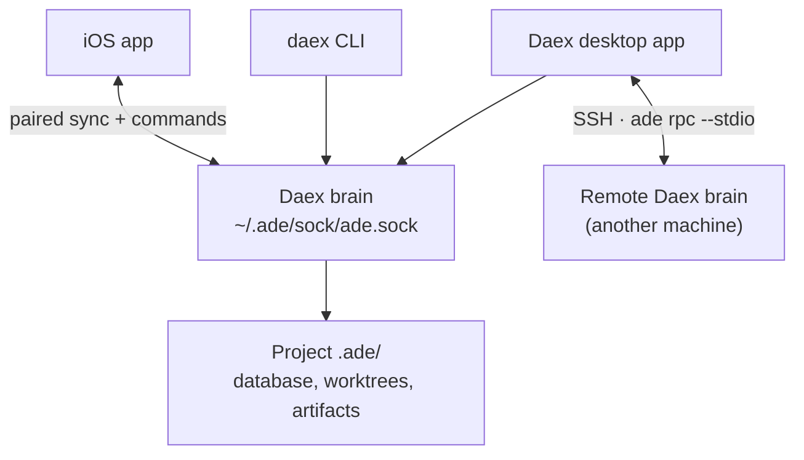

Daex has three parts: **machines** that run the work, the **Daex account** that holds what you read with no machine awake, and **clients** that show both. You don't need a machine of your own: every account has **Daex Cloud**.

On each machine, the center is the **brain** — the always-on, machine-owned Daex process for a channel. The brain owns the project catalog, the durable project state, the sync websocket, and the authority to run agents. Everything you see is a **client** of that brain: the desktop app, the web client, the `daex` CLI, the iOS app, and any SSH-attached desktop window.



## Daex Cloud and the account

Daex Cloud is one machine that every account always has. It shows in every machine list and every **Run on** menu, next to your own computers. Each cloud lane gets its own Linux computer underneath, which you never manage: it sleeps when idle and wakes when you send it work.

- **Reading never wakes a computer.** Saved chats, CLI sessions and shells, a Git summary, files and history from GitHub, pull requests, the CTO, automations, Linear and Jira all come from your account or from GitHub.
- **Doing wakes it.** Sending a message, running a command, opening a changed file or a Git action wakes the lane's computer. Daex never blocks the screen while it wakes. A message to an asleep chat waits on Daex's server and is delivered once.
- **Your account syncs** API keys, Passwords and secrets, provider sign-ins, launch defaults and quick slots to every machine, Daex Cloud included. A browser never reads a secret value.
- **An offline computer of your own is hidden.** An asleep cloud computer is not offline: its work stays listed.

See [Daex Cloud](/cloud/overview).

## The brain

The brain is the source of truth on a machine. It owns lanes, agent chats, terminals, Git operations, PR actions, provider sessions, proof artifacts, the project catalog, and the sync service. It runs every supported provider runtime against the same projects. Because desktop and CLI clients call the same brain, a chat you start in the app and one you start with the `daex` CLI operate on the same project state.

The brain installs as a per-user login service — launchd on macOS, a systemd user service on Linux, a per-user startup entry on Windows — so it stays running even when no window is open. None of them need administrator rights. The [one-command install](/getting-started/install) sets this up, and [`daex connect`](/getting-started/connect-machine) publishes the machine to your account so every client can find it.

Because the brain is the whole engine, a machine does not need a desktop app to be useful. On Linux you can use the desktop app or install the brain on a server and drive it from a client elsewhere.

## Clients

<CardGroup cols={2}>
  <Card title="Desktop app" icon="display">
    The Electron control plane — windows, navigation, the renderer UI, and platform integrations. Each window attaches to a local brain, or binds to a remote one over SSH. macOS-only integrations such as the iOS Simulator drawer are hidden on [Windows](/getting-started/windows).
  </Card>
  <Card title="iOS app" icon="mobile-screen">
    A SwiftUI controller. It reads your account and Daex Cloud, and pairs with your own machines over WebSocket. It never runs agents itself.
  </Card>
  <Card title="daex CLI" icon="terminal" href="/reference/cli">
    The typed control plane for any shell — used by humans and by the agents running inside Daex.
  </Card>
  <Card title="Web client" icon="globe" href="https://app.ade-app.dev">
    The same workspace in a browser, for Daex Cloud and any machine you have connected to your account.
  </Card>
  <Card title="Daex SDK" icon="cube" href="/sdk/overview">
    Third-party apps spawn an embedded runtime as a guest sidecar (`@ade-dev/sdk`, `@ade-dev/chat-ui`). Not a client of the machine brain — an isolated child process.
  </Card>
</CardGroup>

## Project state

Daex writes local state under each repository's `.ade/` directory and leaves your source tree under Git's control:

```text
.ade/
  ade.db        # the project database
  worktrees/    # one git worktree per lane
  artifacts/    # proof and capture artifacts
  secrets/      # encrypted project credentials
```

A **lane** is a git worktree under `worktrees/`. Daex uses real Git branches, worktrees, commits, and PRs rather than replacing them, so a lane is a normal checkout on disk you can also open in any editor.

## Remote runtimes over SSH

A desktop window can bind to a brain on **another machine** over SSH. Daex runs `ade rpc --stdio` on the remote and tunnels the same JSON-RPC back, so lanes, chats, diffs, and PRs behave exactly as they do locally — but the agents, builds, and tests run on the remote, against its filesystem and its own GitHub, Linear, and provider credentials. The desktop stays local and stays the control plane.

This is the no-account path: the desktop bootstraps the runtime on the far side itself. The alternative is to install the brain on that machine and run [`daex connect`](/getting-started/connect-machine), which publishes it to your account directory so desktop, web, and iOS can all reach it without SSH.

<Note>
iOS does not SSH into machines. The phone pairs with a brain and connects to its sync websocket over the LAN or a Tailscale tailnet — install Tailscale on both when they aren't on the same network.
</Note>

<CardGroup cols={2}>
  <Card title="Key concepts" icon="lightbulb" href="/key-concepts">
    The product vocabulary — brain, lane, stack, CTO — in two minutes.
  </Card>
  <Card title="daex CLI" icon="terminal" href="/reference/cli">
    The typed control plane behind everything Daex does.
  </Card>
</CardGroup>
