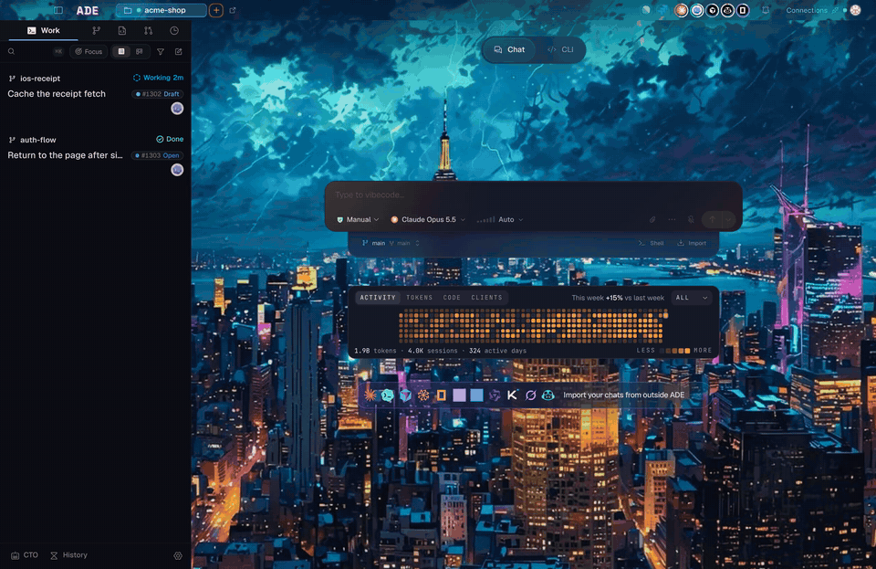

ADE does not ship its own coding agent. It runs **provider** runtimes — the same CLIs and SDKs you already use — and gives them a shared workspace.

## Providers

A provider is an agent runtime with its own tool loop, prompt, and authentication. ADE drives thirteen:

| Provider | Runtime | Credential |
|---|---|---|
| **Claude Code** | Anthropic's Claude Agent SDK | Claude subscription or Anthropic API key |
| **Codex** | OpenAI's `codex` app-server | ChatGPT plan or OpenAI API key |
| **Muse Code** | Meta's Muse runtime | Muse account |
| **Cursor** | Cursor's official SDK | Cursor account |
| **Factory Droid** | Factory's `droid` CLI | Factory account |
| **OpenCode** | The OpenCode server | OpenCode plan, provider keys, or local models |
| **Pi** | ADE's pinned Pi runtime | Any provider Pi can sign in to |
| **GitHub Copilot** | Copilot runtime | GitHub Copilot |
| **Qwen** | Agent Client Protocol | Qwen account |
| **Kimi** | Agent Client Protocol | Moonshot account |
| **Grok** | Agent Client Protocol | xAI account |
| **Devin** | Agent Client Protocol | Devin account |
| **Antigravity** | Agent Client Protocol | Antigravity account |

The five ACP providers share one host and one session-config shape. The rest each have their own adapter.

<Note>
ADE downloads its own pinned copy of each runtime for the machine that runs the chat, the first time it is needed. It never runs an agent CLI from your `PATH`. Model calls go from your machine to the provider, not through ADE.
</Note>

## Models

A model is selected per session, not per project. You can switch models inside the same provider mid-session, and start a different session on a different model in the same lane.

That is the point of separating the two: the agent runtime decides *how* work happens, the model decides *how well* it reasons, and neither choice locks the other.

<Frame caption="The composer carries the session's model, permission mode, and reasoning effort.">
  
</Frame>

## Credentials and cost

Every turn is priced against what actually paid for it: a subscription plan, an API key, or a local model at zero cost. ADE's usage surfaces report by account, so a mixed setup stays legible.

You can mix credentials freely — a Claude subscription for chat, an API key for a cheaper model on a side task, a local model through Ollama for offline work.

## Harnesses and routes

A **harness** is the agent program ADE runs, such as Claude Code, Codex, Droid or Pi. Usually a harness runs on its own provider's models. A **custom provider** pairs a harness with a model from somewhere else (another provider's sign-in, a provider connected inside OpenCode, or a stored API key) and saves it with a name and logo. Claude Code can run on your ChatGPT plan, or Codex on your Claude plan, using the sign-ins you already have.

Custom providers are saved to your ADE account and appear as the first tab of every model picker. Agents and scripts list the choices with `ade harness routes`, then launch on a saved custom provider with `--preset` or on any route with `--via`. See [custom providers](/configuration/ai-providers#custom-providers-any-harness-on-a-plan-you-have).

## Skills

Agents can load **Agent Skills** — packaged instructions for a task. ADE injects the skill roots and the guidance to read them on demand, so a session can follow a project's own procedures without you pasting them into the prompt.

<CardGroup cols={2}>
  <Card title="AI providers" icon="brain" href="/configuration/ai-providers">
    Connect subscriptions, keys, and local models.
  </Card>
  <Card title="Provider setup" icon="plug" href="/getting-started/connect-provider">
    The first-run path for one working provider.
  </Card>
  <Card title="Chat capabilities" icon="toolbox" href="/chat/capabilities">
    What an agent can do inside a lane.
  </Card>
  <Card title="Subagents" icon="users" href="/concepts/subagents">
    Delegating work to the same provider or a different one.
  </Card>
</CardGroup>
