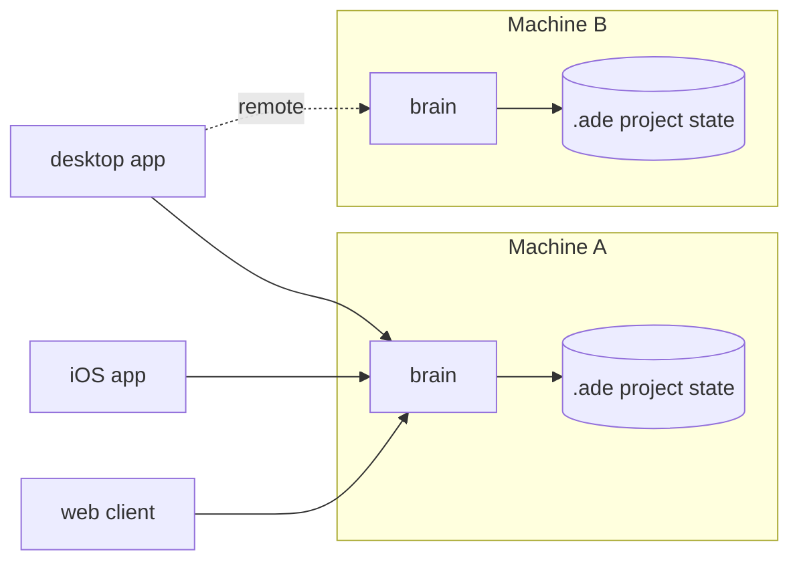

A **machine** is a computer running the Daex **brain**: the always-on process that owns projects, lanes, chats, terminals, Git state, and proof. A **client** is any surface that attaches to a brain.

That split is why the computer in front of you does not have to be the computer doing the work. Your laptop can drive a desktop at home running three lanes, or a headless Linux box running tests. And you do not need a computer of your own at all.

## Daex Cloud

Every Daex account always has one machine, **Daex Cloud**. It shows in every machine list and every **Run on** menu, on the web, the iPhone and the desktop, next to your own computers. Pick it to start a lane there. Each cloud lane gets its own Linux computer underneath; you never see or manage those computers.

A cloud computer sleeps when nothing runs on it. **Asleep is not offline:** its lanes, chats, CLI sessions and shells stay listed, and you can read them. Reading never wakes it. Sending a message, running a command, opening a changed file or a Git action wakes it, and the screen never waits for that. See [Daex Cloud](/cloud/overview).

## Clients

| Client | Runs on | What it is |
|---|---|---|
| Desktop app | macOS, Windows, Linux | The full control plane: Work, Lanes, Files, PRs, CTO, Settings. |
| `daex` CLI | macOS, Linux, Windows | Typed commands for agents and scripts over the same lanes and chats. |
| Web client | Any browser | The full Daex in a browser, for Daex Cloud and your connected machines. |
| iOS app | iPhone | Follow chats, review, and answer questions from anywhere. |
| SSH-attached desktop | Any host | A desktop window attached to a brain on another machine. |

A client never owns a chat. Sessions live on the machine's runtime, so the same conversation appears on every client attached to it.

## Account and pairing

Signing in with the same account links your machines into one list, with Daex Cloud always in it. `daex connect` adds a machine; a machine with no browser shows a QR code you scan from the phone. An own computer that is offline is hidden until it is back. You can also skip the account and use one machine locally — you just cannot reach it from anywhere else, and you have no Daex Cloud.

## Where state lives

Each project keeps its Daex state in `.ade/` inside the repository: the local database, worktrees, artifacts, and caches. Your source tree stays under Git's control. Machine-wide state lives in the Daex home directory, not in the repository. Your Daex account keeps your projects, settings, API keys, Passwords and sign-ins, launch defaults and quick slots, and gives them to every machine. It also keeps saved copies of Daex Cloud work, so you can read them with no computer on. Chats without a project stay on their machine.

## What follows from this

- **A lane belongs to its machine.** Chats and terminals for that lane run there and only there.
- **A chat can still borrow another machine.** It can run a command or a simulator on another of your machines in a hidden work copy there, without moving the chat or making a lane; see [use another machine from the chat](/tools/remote-machines#use-another-machine-from-the-chat-you-are-in).
- **Remote actions are scoped.** The app passes the target machine with every action; see [remote machines](/tools/remote-machines).
- **Killing a client does not kill the work.** The brain keeps running, and a chat can be resumed from another client.

<CardGroup cols={2}>
  <Card title="Connect a machine" icon="server" href="/getting-started/connect-machine">
    Add a laptop, desktop, or headless server to your account.
  </Card>
  <Card title="Architecture" icon="sitemap" href="/architecture">
    How the brain, clients, and data plane fit together.
  </Card>
</CardGroup>
