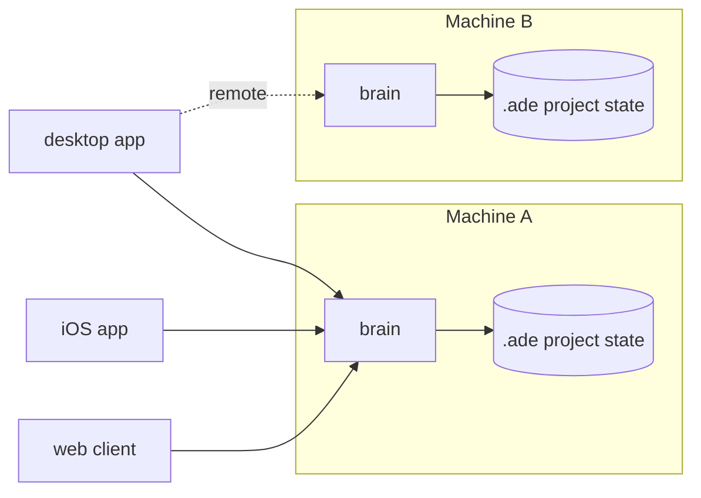

A **machine** is a computer running the ADE **brain**: the always-on process that owns projects, lanes, chats, terminals, Git state, and proof. A **client** is any surface that attaches to a brain.

That split is why the computer in front of you does not have to be the computer doing the work. Your laptop can drive a desktop at home running three lanes, or a headless Linux box running tests.

## Clients

| Client | Runs on | What it is |
|---|---|---|
| Desktop app | macOS, Windows | The full control plane: Work, Lanes, Files, PRs, CTO, Settings. |
| `ade` CLI | macOS, Linux, Windows | Typed commands for agents and scripts over the same lanes and chats. |
| Web client | Any browser | Owner-only hosted view over the sync connection. |
| iOS app | iPhone | Follow chats, review, and answer questions from anywhere. |
| SSH-attached desktop | Any host | A desktop window attached to a brain on another machine. |

A client never owns a chat. Sessions live on the machine's runtime, so the same conversation appears on every client attached to it.

## Account and pairing

Signing in with the same account links your machines into one list. `ade connect` adds a machine; a machine with no browser shows a QR code you scan from the phone. You can also skip the account and use one machine locally — you just cannot reach it from anywhere else.

## Where state lives

Each project keeps its ADE state in `.ade/` inside the repository: the local database, worktrees, artifacts, and caches. Your source tree stays under Git's control. Machine-wide state (accounts, machine list, provider credentials) lives in the ADE home directory, not in the repository.

## What follows from this

- **A lane belongs to its machine.** Chats and terminals for that lane run there and only there.
- **Remote actions are scoped.** The app passes the target machine with every action; see [remote machines](/tools/remote-machines).
- **Killing a client does not kill the work.** The brain keeps running, and a chat can be resumed from another client.

<CardGroup cols={2}>
  <Card title="Connect a machine" icon="server" href="/getting-started/connect-machine">
    Add a laptop, desktop, or headless server to your account.
  </Card>
  <Card title="Architecture" icon="sitemap" href="/architecture">
    How the brain, clients, and data plane fit together.
  </Card>
</CardGroup>
