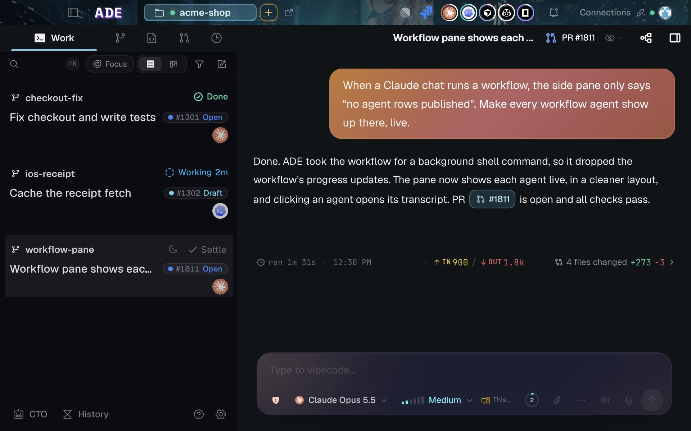

**Work** is where execution happens. A Work session is one of three things:

| Session | What it is | Use it for |
|---|---|---|
| **Agent chat** | A streaming conversation with a coding agent, scoped to a lane. | Most changes: read, edit, run, review. |
| **Terminal** | A plain shell in the lane's worktree. | Servers, REPLs, one-off commands you drive yourself. |
| **CLI session** | A provider's own terminal client (`claude`, `codex`, …) tracked by ADE. | When you want the provider's native CLI, with ADE keeping the transcript and status. |

All three are owned by the machine's runtime, not by the window you opened them in.

<Frame caption="A Work session: the transcript, its diff summary, and the composer in one column.">
  
</Frame>

## What every session shows

A session row answers four questions at a glance: what it is doing, which lane it belongs to, how long it has been running, and what it needs from you. The same status follows the session to the phone and the terminal.

Sessions can report two extra details about themselves:

- A short **note** — a one-line summary of what the session is doing right now.
- An **activity** — planning, exploring, implementing, testing, debugging, reviewing, shipping, or monitoring.

ADE also infers activity from what the agent is doing, so a row is useful without the agent having to narrate.

## Focus, and settling a chat

The Work sidebar opens with **Focus** on, on desktop and iOS: busy lanes fold away until they need you. Turn it off and it stays off. The **Working**, **Snoozed**, and **Settled** groups count chats, not lanes, and a chat nested under a parent chat is counted once.

Settling a chat only files it out of the way. It stops nothing: background shells, subagents, cloud runs, scheduled wakes and crons keep running. A chat that is mid-turn cannot be settled, and any new turn (your message, a wake, a cron, a subagent reporting back, or a resume after a restart) takes the chat out of Settled. After an ADE restart a settled chat resumes like any other; an archived one does not.

## Background and scheduled work

Agent work does not have to happen while you watch. A chat can be launched in the background, and any chat runtime can schedule its own durable future work: a wake in ten minutes, a daily cron, or a re-check when CI finishes.

Scheduled work is ADE-owned rather than provider-owned, so every provider uses the same scheduler and the same delivery path. Wake, cron, and background events stay visible in the transcript and in Chat Info.

<Card title="Scheduled work and automations" icon="clock" href="/tools/automations" horizontal>
  Event-triggered rules, webhooks, and durable scheduled resumes.
</Card>

## Closing a session

A session ends with a structured closeout: status, summary, artifacts, and any blocker, shown as a card in the transcript. Stopping a chat interrupts the turn; the transcript stays, and the chat can be resumed.

<Tip>
A session you closed is not a session you lost. Chats are resumable and searchable, and History keeps the timeline of what happened. A chat you deleted can come back too, from **Settings › Storage & cleanup › Recently deleted**, while its agent still has its copy.
</Tip>

<CardGroup cols={2}>
  <Card title="Agent chat" icon="comments" href="/chat/overview">
    The interactive surface: tool calls, diffs, approvals, questions.
  </Card>
  <Card title="Terminals" icon="terminal" href="/tools/terminals">
    Shells in the lane, and how they relate to chats.
  </Card>
</CardGroup>
