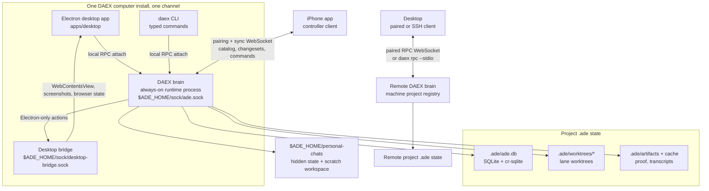

# DAEX Architecture Reference

The technical entry point for engineers and agents: how the apps fit, where
state lives, the IPC contract, and the cross-cutting rules. Each section points
to the feature doc that holds the detail. Product scope is in
[PRD.md](./PRD.md). The code is the source of truth.

DAEX was called ADE until 2026-11-28. Code identifiers, `ADE_*` env vars,
`.ade/` folders, `~/.ade`, file names and `window.ade` keep the old name on
purpose; see [brand/README.md](./brand/README.md).

---

## 1. System at a glance

DAEX orchestrates AI-assisted software engineering across parallel git
worktrees ("lanes") and also hosts projectless personal chats. It works fully
with no computer of your own: every account always has one machine, **DAEX
Cloud**, next to the person's own computers (section 1.1).

On each machine the center is the **brain**: the always-on DAEX process for one
channel (`apps/ade-cli/`). It hosts every project on that machine through a
project registry, owns a separate personal-chat scope, exposes both through one
JSON-RPC surface on the channel's local endpoint, serves the sync WebSocket,
and carries executor authority. Desktop windows, the iPhone app, the hosted web
client and SSH-attached desktop windows are **clients** that attach to a brain
and call runtime-owned actions through that one surface.

The brain owns everything that must survive a client closing: lane worktrees,
agent chats for 13 providers, the CTO agent, automations, PR actions, proof, the
sync service, and the per-machine credential store. Agents run on the machine
that owns the lane; model calls go from that machine to the provider, never
through DAEX's servers. DAEX's servers (the Cloudflare Workers in section 2.6)
hold the account: the machine list, DAEX Cloud, saved copies of cloud work,
account settings and the encrypted vault.

### Brain and runtime topology



The **sync service runs inside the brain**, not in the desktop app. Live state
replicates between paired devices as cr-sqlite changesets over WebSocket. The
sync WebSocket is one brain-level listener on a stable port (default 8787,
`DEFAULT_SYNC_HOST_PORT`); when the hosted project switches, the new project's
host service adopts the connected phones. A second desktop is a client of that
brain, not a peer host. A desktop window binds to a remote brain over the paired
DPoP channel (LAN, then tailnet, then DAEX Relay) or, for an eligible target,
over SSH `daex rpc --stdio`. The binding is per window, and both transports
route through the same multi-project JSON-RPC surface. See
[remote-runtime](./features/remote-runtime/README.md).

Source code crosses machines through plain git. DAEX does not host a git server.

### 1.1 No computer of your own: DAEX Cloud and the account

DAEX Cloud is one machine every signed-in account always has. Every machine
list and every "Run on" menu shows it, on web, iPhone and desktop. Its machine
id is `__ade_cloud__` (`apps/desktop/src/shared/adeCloudMachine.ts`). Each cloud
lane has its own Linux computer underneath, with a brain like any other
machine. No surface shows these computers as machines.

```
  web client · iPhone · desktop · daex CLI
      |                 |                       |
      | reads           | does (send, run, Git) | own computers
      v                 v                       v
  account Workers  --wake-->  cloud lane computer   Mac / PC / Linux brain
  (account-directory,          (brain; sleeps when     (connected: listed;
   push-relay, R2, D1)          idle; saves at rest)    offline: hidden)
      ^                                 |
      +------ saved copies, Git summary, capsules, lane index ------+
```

**The rule for every surface.**

- A tab shows the connected own computers plus DAEX Cloud, always. A project
  tab with no own computer online binds to DAEX Cloud and keeps the normal tabs
  and composer.
- An offline own computer is hidden in Work, Lanes and the welcome page. An
  asleep cloud computer is not offline: its lanes and work stay listed.
- Reading never wakes a computer. Reads come from the account Workers or from
  GitHub. Doing (send, run, open a changed file, a Git action, continue) wakes
  the lane's computer through the account (`cloudSleep.ts`
  `wakeCloudMachineForUse`), and the UI never waits on the wake.
- Every action on a cloud lane goes to that lane's own computer by its pin.

**What the account keeps for cloud lanes** (`apps/account-directory/src/cloud/`):

| Data | Written by | Read by |
|---|---|---|
| Chats, after each turn (encrypted per user, R2) | the cloud computer (`cloudChatUploader.ts`) | Work, saved chat panes |
| CLI sessions, shells (last 5,000 lines) and subagents | the computer at rest (`cloudRestSave.ts`; server `sessionCopies.ts`) | Work, read-only copies |
| Git summary: branch, ahead/behind, changed files | the computer at rest (server `gitSummaries.ts`) | Files, Git, History, resting lane detail |
| Fork capsules of each chat | idle cleanup's prepare step (server `forkCapsules.ts`) | the continue on a new computer |
| Messages for an asleep or deleted chat or CLI | clients (`POST /cloud/chats/:m/:c/messages`, server `chatMessages.ts`) | the computer, which claims and reports each once (`cloudChatMessageQueue.ts`) |
| Account lane index: name, branch, machine, PR number | every machine (`accountLaneIndexPublisher.ts`; server `src/accountLanes/`) | mentions of a lane only (PR rows, notifications, CTO, search); never the Lanes tab |
| CTO copy, automations, limits, sign-in status | brains and Settings | the CTO page, Automations, Settings with no computer |

Only cloud computers upload chats and sessions. Own computers never do. Proof
is never uploaded.

**Idle cleanup** deletes an unused cloud computer after a warning, in the order
prepare, push, save for rest, check (`planCleanup.ts`, `idleCleanup.ts`). The
lane's chats show a "deleting soon" band with **Keep it**
(`components/cloudLane/CloudLaneDeletingSoonBand.tsx`). The next message to a
deleted computer's chat starts a new computer that continues the chat **in the
same chat row** (`cloudChatRestore.ts`). Claude, Codex and OpenCode restore
their native session from the capsule; the other 10 providers replay the saved
transcript.

**Refusals.** The server refuses a wake or a create with a code and one
sentence (out of hours, too many awake, blocked, deleting, over the plan's disk,
`plan_past_due`, `too_many_messages`). Every client shows that sentence. A
blocked account reads and exports its saved chats and cannot wake or create.

**Event wakes.** A Linear event or a webhook for an asleep computer wakes it:
the webhook relay calls `/cloud/internal/event-wake` (`eventWakes.ts`), gated by
`CLOUD_EVENT_WAKE_SECRET`.

**Linear and Jira with no computer.** The account server reads Linear and Jira
with the project's vault connection (`POST /cloud/integrations/linear/query`,
`.../jira/search`, `.../jira/issue`; `src/cloud/integrations.ts`). Reads only,
30 requests a minute per account. An expired grant from DAEX's own Linear OAuth
app is renewed by the server (`linearRenewal.ts`); a grant from a person's own
OAuth app still needs a computer. See
[linear-integration](./features/linear-integration/README.md#with-no-computer).

**Account sync.** The vault and account settings reach every machine, DAEX
Cloud included: one API key store (`provider_api_key`), Passwords and secrets,
provider sign-ins and DAEX proxy logins as access-only copies, launch defaults
and quick slots, and DAEX Cloud agent limits (`/cloud/limits`). A browser never
reads a secret value: the push relay answers a request with an `Origin` header
only on `BROWSER_ACCOUNT_ROUTES` (`apps/push-relay/src/relay.ts`), and none of
them returns a secret. Personal chats stay on their machine.

**Git identity on a cloud computer.** The computer sets the account's GitHub
noreply identity, else `DAEX Cloud <cloud@users.noreply.ade-app.dev>`
(`apps/ade-cli/src/services/github/cloudGitIdentity.ts`). It never writes over
a value a person set.

**Not built.** Moving a lane or a chat onto DAEX Cloud, and web push.

Details: [ade-cloud](./features/ade-cloud/README.md),
[web-client](./features/web-client/README.md).

---

## 2. Apps and processes

### 2.1 DAEX brain and runtime (`apps/ade-cli/`)

`apps/ade-cli/` holds the brain, the manual runtime entry points and the `daex`
CLI (`ade` is a permanent alias; both names are `bin` entries for
`dist/cli.cjs`). It ships as one Node binary with several run modes:

- **Brain** (`daex serve`). Boots the multi-project JSON-RPC server, hosts
  per-project services on demand, serves sync, and listens on the channel's
  endpoint: POSIX `$ADE_HOME/sock/ade.sock` (directory `0700`, socket `0600`),
  Windows `\\.\pipe\ade-runtime-<channel>-<hash>`. `machineLayout.ts` derives
  the Windows hash from the canonical home, channel and the profile folder of
  the process token's account, so users and channels never collide and every
  session of one user reaches one brain. Installed as a login service with
  `daex brain start` / `daex brain stop` (`src/serviceManager/`). A brain a
  desktop connects to runs at role `cto` (`daex --role cto serve`).
- **Manual runtime** (`daex runtime run --socket <path>`). A foreground runtime
  on an explicit endpoint. Sync is always off, so it never claims brain
  authority. `--profile embedded` marks it a guest of an external embedder
  (`@daex-dev/sdk`): personal-chat scope, no automations, no machine-update or
  power controls, and a parent-death watchdog (`parentDeathWatchdog.ts`,
  `ADE_EMBEDDED_PARENT_PID`). See [SDK](./features/sdk/README.md).
- **Single command** (`daex <command>`). Connects to the local brain, runs one
  action and exits. `--headless` boots a project's services in process instead,
  for CI and scripts; calls whose state lives in the brain (chats, sessions,
  terminals, devices, browsers, schedules; `lib/liveRuntimeActions.ts`) then
  fail with the reason instead of a stub answer. Version skew with a running
  brain is handled by `lib/brainVersionSkew.ts`: a protocol-compatible brain is
  used as it is and never replaced unless it runs this CLI's own entry file; an
  incompatible one is refused in one line.
- **SSH stdio bridge** (`daex rpc --stdio`). JSON-RPC over stdin/stdout. The
  desktop's `RemoteConnectionPool` runs it over SSH after
  `bootstrapRemoteRuntime` uploaded a matching `ade-<platform-arch>` binary.

**Startup invariants.**

- The brain binds its RPC endpoint *before* the sync host starts
  (`runServe`, `startSyncHostInBackground`), so desktop reachability never
  waits on phone sync. `assertBrainSocketUnowned` runs right before `listen()`
  so a brain that cannot own its socket fails fast; on shutdown
  `unlinkOwnedRuntimeSocket` removes the socket only if it still owns that inode.
- `runtimeSpawnRecord.ts` stops CLI runs from stacking detached brains: a spawn
  is suppressed while an earlier spawned brain is alive and within
  `RUNTIME_SPAWN_RECORD_GRACE_MS`.
- `createAdeRuntime` registers each release as it acquires a resource
  (`services/runtime/startupTeardown.ts`) and drains them in reverse on failure,
  the same drain `runtime.dispose` uses.
- `ProjectScopeRegistry` backs off a project that failed to boot (up to
  `FAILED_SCOPE_BACKOFF_MAX_MS`) and rethrows the recorded error instead of
  booting again.

**Machine and multi-project RPC.** Runtime-scoped methods (`projects.*`,
`sync.*`, `runtime/info`, `machineInfo.get`, `machine.updateAndRestart`,
`machine.reportPowerTransition`, `runtimeEvents.*`) are answered directly.
Project-scoped work goes through `ade/actions/call` with a `projectId`.
Personal chats use separate machine methods (`personalChats.call`,
`personalChats.streamEvents`, `personalChats.subscribeEvents`) and never enter
project dispatch. Per-project services boot lazily in `ProjectScopeRegistry`
(`services/projects/projectScope.ts`); `PersonalChatScope`
(`services/personalChats/personalChatScope.ts`) boots a chat-only runtime under
`$ADE_HOME/personal-chats`. `projectRegistry.ts` is the durable project list;
`machineLayout.ts` resolves every machine path under `$ADE_HOME`. Wire formats
are in `multiProjectRpcServer.ts`.

Event replay uses `eventBuffer.ts`, a bounded buffer that returns `eventEpoch`,
`gap` and `oldestCursor` so clients detect a restart or evicted history.
Transient events (App Control screencast frames) reach live listeners but are
never retained. Each drain stops at a byte budget, and a local client too far
behind is disconnected and reconnects from its cursor.

**Runtime-side services** (`apps/ade-cli/src/services/`), the ones a newcomer
meets first:

| Directory | Role |
|-----------|------|
| `projects/` | Project registry, per-project scope, machine layout, account projects. |
| `personalChats/` | Machine-owned personal-chat runtime and its allowlisted ingress. Runs as the SDK guest under `runtimeProfile: "embedded"`. |
| `sync/` | Sync service, pairing, device registry, PIN store, protocol, remote commands, relay tunnel client, Tailscale resolver. The desktop's old in-process sync host is off unless `ADE_ENABLE_DESKTOP_SYNC_HOST=1`. |
| `account/` | Required account sign-in: loopback OAuth, the device-code bridge for SSH and display-less hosts, `account.session.v1` refresh storage, `ADE_ACCOUNT_TOKEN`. The brain is the only refresher; desktop and CLI ask it for access tokens. |
| `credentials/` | Per-machine credential store (section 8.1). |
| `runtime/` | Watchdogs, heartbeat, spawn records, startup teardown, update and restart, the `ADE_CLI_PATH` shim (`adeCliShim.ts`). |
| `remoteMcp/` | DAEX MCP: each computer as an MCP server through the relay. See [ade-mcp](./features/ade-mcp/README.md). |
| `proof/adeCaptureRegistry.ts` | Files the brain's capture actions wrote; ingest counts as DAEX's own capture only on a match. See [proof.md](./features/proof.md). |
| `workTools/workToolShowRequests.ts` | `daex ui show <surface>`: asks the desktop showing that chat to open a surface. |

`src/lib/cliDelegation.ts` hands a `daex` run to `ADE_CLI_PATH` when that path
is a different CLI entry, so a shell rc that puts an older CLI first on `PATH`
still reaches the one DAEX meant (`ADE_CLI_NO_DELEGATE=1` turns it off). The
command families are documented in [`apps/ade-cli/README.md`](../apps/ade-cli/README.md).

**Service managers.** `installLaunchd.ts` (macOS), `installSystemd.ts` (Linux)
and `installWindows.ts` (Windows) register the brain as a login service.
Windows uses a per-user, per-channel `HKCU\...\Run` entry that starts a
PowerShell supervisor (no administrator rights needed). All three share
`serviceHandover.ts` and `runtimeServiceBudgets.ts`: a `ServiceManagerResult`
can be `starting` (registered and alive, not answering yet), which callers
treat as a slow start, not a failure. On macOS the brain runs as
`Contents/MacOS/DAEX Brain` (the bundle keeps the old `ADE Brain` copy for
launch agents an older build wrote), a signed copy of the app executable
(`serviceManager/brainExecutable.ts`), so quitting the app leaves the brain
serving. `brainFreshnessMonitor.ts` restarts an idle brain whose CLI entry on
disk changed. See [remote-runtime](./features/remote-runtime/README.md).

**Watchdogs.** Both write `event-loop-wedge.json`; the next boot reports it
through `runtimeInfo.lastWedge`.

- In process: `services/runtime/brainLoopWatchdog.ts`, a worker thread that
  kills the brain after a heartbeat stall past `ADE_LOOP_WATCHDOG_MS` (30 s)
  with no sleep signal.
- External: `daex runtime watchdog-check` (`brainWatchdogCheck.ts`) reads
  `<home>/runtime/heartbeat.json` and kills only a confirmed stale beat from the
  same process incarnation, never after the machine slept. macOS runs it from
  the `com.ade.watchdog` launch agent; on Windows the supervisor applies the
  same rules.

Details: [storage-and-recovery](./features/storage-and-recovery/README.md).

**Session identity.** The runtime resolves a caller's role (`cto`, `agent`,
`external`, `evaluator`) from DAEX context env vars and flags.
`ADE_DEFAULT_ROLE` is a ceiling, not a grant: `resolveSessionBoundRole` clamps a
chat-bound caller to `agent`. Chats get `ADE_CHAT_SESSION_ID` and
`ADE_DEFAULT_ROLE=agent`. Brains launched from an agent shell scrub inherited
session identity. Chat ownership is checked against a process registry shared
across homes, so a separate home does not make a live chat adoptable; see
[one brain per chat](./features/chat/README.md#one-brain-per-chat).

**Trusted provenance on chat messages.** `chat.messageSession`,
`chat.sendMessage` and `chat.steer` pass through `withTrustedAgentProvenance`
in `adeRpcServer.ts`, which deletes caller-supplied provenance keys and
re-derives them. That provenance decides whether a child's completion wakes its
parent. See [mission ownership](./features/chat/README.md#mission-ownership-decides-the-wake).

**Action policy.** Every runtime action is allowlisted per role in
`actionPolicy.ts` and declared `read` or `write` in
`apps/desktop/src/shared/adeActionAccess.ts` (an unknown action counts as a
write, and a test fails when the two disagree). Agents cannot settle their own
sessions. Chats form a mesh: a bound agent may read, interrupt, stop or restart
any chat (`CHAT_ACTION_SCOPE` entries marked `mesh`), while self-reporting,
billing and scheduling stay limited to the caller's own session. User-only
domains such as `lane_share` admit only a desktop client with no agent identity
(`mayUseUserOnlyActions`). Account settings use `account_settings`; vault
values use `account_vault`, which is host/CTO policy-gated.

**Bundled runtime artifacts.** Per-platform `ade-<platform-arch>` binaries and
their native tarballs live under `apps/desktop/resources/runtime/`. A desktop
package bundles only its own target
(`apps/desktop/scripts/runtime-resource-targets.cjs`, `ADE_RUNTIME_TARGET`).
`remoteSidecarCache.ts` fetches another target's pair from the desktop's exact
release tag, checks it against `SHA256SUMS`, and caches it under
`<home>/runtime-sidecars/<tag>/<target>/`, so any desktop can bootstrap macOS,
Linux and Windows x64 machines over SSH. Windows bootstrap needs OpenSSH
Server, PowerShell 5.1+ and `tar.exe`.

**Headless install and update.** `curl -fsSL https://ade-app.dev/install.sh | sh`
(Windows: `irm https://ade-app.dev/install.ps1 | iex`) installs a standalone
runtime; `daex brain update` updates it. Staging and backups sit next to what
they replace under the home (never in `$TMPDIR`), the new binary is
preflighted against the staged runtime, and a failure rolls back. Remotely,
`machine.updateAndRestart` (`services/runtime/machineUpdateAndRestart.ts`,
`cto` only; sync commands `machine.updateImpact` / `machine.updateAndRestart`)
runs the same update; it refuses when the host is already on the named version,
and its `restart` step answers `pending` because the process answering is the
one being replaced. When the host's desktop app is open, the request goes to
that app over the desktop bridge (`app_update.install`). Release tags carry a
`v` prefix: `releaseAssetUrl` (`lib/releaseAssets.ts`) maps a bare version to
its tag.

**CLI on PATH from the desktop.** macOS and Linux get a launcher at
`$HOME/.local/bin/ade`; `ensureUserBinOnShellPath` adds a marked `PATH` line to
the shell rc when needed. Windows gets `%LOCALAPPDATA%\ADE\bin\ade.cmd` (plus an
extensionless `ade` for Git Bash) and an HKCU `Path` update. The launcher file
names keep the old name.

**Desktop bridge.** The brain runs as Node (`ELECTRON_RUN_AS_NODE=1`), so it has
no renderer-side Electron APIs. Services that own real desktop UI, mainly
`BuiltInBrowserService` (the Browser pane's `WebContentsView`), live in desktop
main and are reached over a side-channel JSON-RPC socket:
`<home>/sock/desktop-bridge.sock` on POSIX, `\\.\pipe\ade-desktop-bridge-<channel>-<hash>`
on Windows (`ADE_DESKTOP_BRIDGE_SOCKET_PATH` overrides). Server:
`apps/desktop/src/main/services/builtInBrowser/desktopBridgeServer.ts`; client:
`apps/ade-cli/src/services/builtInBrowser/desktopBridgeClient.ts`; the shared
method allowlist is `BUILT_IN_BROWSER_DESKTOP_BRIDGE_METHODS` in
`desktopBridgeMethods.ts`. The socket is owner-only and carries no token: any
process of this user may drive the browser. `adeRpcServer.ts`
(`scopeBuiltInBrowserAdeActionArgs`) replaces caller routing with the calling
chat's own id and lane, so a chat owns its tabs. With no desktop attached, a
call fails with a clear "no desktop browser attached" error and every other
domain keeps working. When the chat's user sits at a desktop on another
machine, the command runs in that desktop's browser (`remoteBrowserForwarder.ts`;
see "The browser where the user sits" in
[remote-runtime](./features/remote-runtime/README.md)).

### 2.2 Electron desktop client (`apps/desktop/`)

The desktop app is a **client of the runtime**: a trusted main process, a typed
preload bridge, the React renderer, and the shared TypeScript contracts the
whole monorepo imports. The data plane lives in the brain.

| Directory | Role |
|-----------|------|
| `src/main/` | Node process with full OS access. Hosts windows, registers IPC, routes runtime-backed APIs through the local and remote pools, spawns the local brain when needed, and owns Electron-only services. Entry: `main.ts`. |
| `src/preload/` | Typed bridge, `contextBridge.exposeInMainWorld("ade", adeBridge)` where `adeBridge` `satisfies Window["ade"]` (`preload/global.d.ts`), so a signature that drifts (a dropped `pin` above all) is a compile error. Entry: `preload.ts`. See section 5. |
| `src/renderer/` | React SPA with no Node, filesystem or direct network access. Everything goes through `window.ade`. Entry: `main.tsx`. |
| `src/shared/` | Types (`shared/types/`), IPC channel names (`ipc.ts`), the model registry, action access (`adeActionAccess.ts`), brand constants (`brand.ts`), and cross-client rules imported by desktop, CLI and web: `projectIdentity.ts` (binding keys `local:<root>` / `remote:<targetId>:<projectId>`), `machineIdentity.ts` (`THIS_MACHINE_ID`, `machineNameForBinding`), `cliLaunch.ts`, `chatEventCompaction.ts`, `prChecksRollup.ts`, `externalSessionPolicy.ts`, `laneDisplayName.ts`. |
| `src/generated/`, `src/test/`, `src/types/` | Build-time generated code, shared Vitest setup, ambient types. |

**Multi-window shell.** `main.ts` hosts several `BrowserWindow`s; each has its
own runtime binding. A window can hold several project tabs; a tab is the
repository, not a machine (`components/app/useRepositoryTabs.ts`). The global
`/chats` route is a machine-level **Chats** tab. External controllers (the CLI)
can drive navigation with the `app/navigate` JSON-RPC method.
`main/windowAppearance.ts` owns the window chrome (macOS `hiddenInset`, Windows
title bar overlay). The packaged appId is `com.ade.desktop` (frozen).

**Account Activity is outside the project binding.**
`attentionAccountCoordinator.ts` sends snapshot, acknowledgment, presence and
preference calls straight to the account push relay, so Activity works whatever
machine the window is bound to. The UI says **Activity**; the wire, IPC, relay,
SQLite and telemetry names stay `attention` (`AttentionItem`, `ade.attention.*`,
`/attention/account/*`). Do not rename them.

**Runtime binding pools.**

- `services/localRuntime/localRuntimeConnectionPool.ts`: client for the local
  brain. Spawns or attaches, registers projects (`projects.add`, re-registering
  once when the brain answers "Unknown projectId"), logs
  `local_runtime.action_slow` past 500 ms, and repairs the background service
  with backoff, suspended during an applying update (`beginUpdateWindow`).
  `probeMachineRuntimeIdentity()` reports what is on the endpoint.
- `services/remoteRuntime/`: the paired and SSH pool. `remoteTargetRegistry.ts`
  stores saved machines in `~/.ade/secrets/remote-machines.json`;
  `sshTransport.ts` is the SSH transport; `remoteBootstrap.ts` uploads and
  version-checks the runtime; `remoteConnectionPool.ts` keeps each window's
  binding alive, replays only actions `isReplaySafeAdeAction` accepts, and
  makes repeated reads conditional (`shared/conditionalActionResult.ts`);
  `remoteConnectionService.ts` tracks status and reconnects;
  `runtimeRpcClient.ts` is the JSON-RPC client. An action that does work and
  outlives its budget keeps waiting while the brain still lists it in
  `ade/requests/status` (`shared/runningRequests.ts`). `remoteBrainStart.ts`
  starts a POSIX remote's brain over SSH only on a connect a person asked for.
  See [remote-runtime](./features/remote-runtime/README.md#a-remote-machine-whose-brain-is-not-running).

Build outputs (`apps/desktop/tsup.config.ts`): `main/main.cjs`,
`main/packagedRuntimeSmoke.cjs` (post-package smoke test) and
`preload/preload.cjs`. Desktop and CLI bundles stay pure ASCII
(`scripts/build/asciiBundleSource.ts`) to halve V8's source memory.

### 2.3 iOS client (`apps/ios/`)

Native SwiftUI controller; the phone never runs agents. With no computer awake
it reads the account (DAEX Cloud lanes, saved chats and session copies, the Git
summary, the CTO copy, Linear) through `CloudServerClient.swift`, and files
from GitHub. With a connected machine it pairs over WebSocket and reads a local
SQLite database that mirrors the project's `ade.db`.

- CRDT: a pure-SQL CRR emulation (trigger-based change tracking), because iOS
  blocks loadable extensions. Changesets are wire-compatible with cr-sqlite.
- Core services: `Database.swift`, `SyncService.swift`, `KeychainService.swift`,
  `DpopKeyService.swift` (Secure Enclave pairing proof),
  `PushNotificationService.swift`, `LiveActivityService.swift`,
  `ProductAnalytics.swift`.
- Project tabs: Lanes, Files, Work, PRs, CTO, Settings. Personal chats open from
  the Hub. Controls are gated on the host's advertised action descriptors, so an
  older brain never receives a mutation it does not support.
- Activity: an account-wide drawer, a Lock Screen widget and one account-wide
  Live Activity (`ADEWidgets/ADEAgentActivityWidget.swift`).
- Connection: account sign-in is the PIN-less path; direct pairing uses a
  user-set 6-digit PIN after the QR or Nearby. Routes race LAN, Tailscale and
  Relay in one wave.
- Target: iOS 26+.

Brand copy comes from `apps/ios/ADE/Shared/Brand.swift`. Details:
[ios-companion](./features/sync-and-multi-device/ios-companion.md).

### 2.4 Hosted web client (`apps/desktop/src/renderer/webclient/`)

A static Cloudflare Pages controller built from the desktop renderer, served at
`app.ade-app.dev`. After account sign-in, a project tab with no own computer
online binds to DAEX Cloud and reads the account and GitHub (section 1.1). For a
connected machine it adopts the machine from the account directory with a
DPoP-bound credential; an HTTPS page cannot dial `ws://` LAN endpoints, so Relay
is normally its only route. It keeps no local database and installs a
sync-backed subset of `window.ade`. `WebMachineSessionManager` holds at most
four live machine connections and parks the least recently used one. A
federated `window.ade` adapter pins project calls to the exact machine and
project; `renderer/webclient/adapter/runtimePinGuard.ts` throws on a pin it
cannot route instead of answering from the wrong host. See
[web-client](./features/web-client/README.md).

### 2.5 Web app (`apps/web/`)

The public site at daex.dev: marketing, pricing, downloads, the smart-QR / App
Clip pairing handoff, the deeplink landing page, privacy and terms. A Vite/React
SPA deployed on Vercel (`apps/web/vercel.json`); not a runtime dependency of the
desktop app. `apps/web/api/` holds the serverless functions: installers and
downloads (`install.ts`, `download.ts`), `/device` (the account sign-in link,
redirected to the account directory's page) and `/open` (`open.ts`, the HTTPS
half of the deeplink scheme, which rewrites OpenGraph tags for link unfurls and
then tries the `daex://` link in the browser; see
[deeplinks](./features/deeplinks/README.md)). The homepage live demo
(`/demo/`) is the desktop renderer built by `npm run build:demo` in
`apps/desktop`. Public-site analytics is separately consented
(`ade_marketing_*`, `marketingAnalytics.ts`); see [logging.md](./logging.md).

### 2.6 Cloudflare Workers (`apps/push-relay/`, `apps/tunnel-relay/`, `apps/account-directory/`, `apps/webhook-relay/`)

Four independent Workers, each with its own package, lockfile and
`wrangler.jsonc`. Worker, D1, R2 and Durable Object names keep `ade-*` names
(frozen: a rename is a new, empty resource).

- **`apps/account-directory/`**: Clerk-authenticated machine directory (D1),
  the OAuth device-authorization bridge, and DAEX Cloud's server (`src/cloud/`,
  every `/cloud/*` route: plans, launches, sleep and wake, the message queue,
  saved chats and session copies, Git summaries, fork capsules, idle cleanup,
  limits, the CTO copy, Linear and Jira reads, event wakes). It also keeps the
  account's projects (`src/accountProjects/`), the account lane index
  (`src/accountLanes/`) and lane shares (`src/laneShares/`). Brains publish
  through `accountMachinePublisherService.ts` (60 s heartbeat; 150 s online
  window). `DELETE /account/machines/:machineKey` is terminal; re-registering
  needs a fresh interactive sign-in or a single-use pairing grant. A resting
  cloud computer reads `sleepState: "asleep"`, not offline.
- **`apps/push-relay/`**: the account vault, account settings, sealed Passwords
  items, and account Activity (it merges the snapshots every signed-in brain
  publishes and fans out APNs alerts and one account-wide Live Activity). D1, no
  Durable Objects. Machine publishes need an HMAC signature and a Clerk token.
  Its routes and stored fields keep `attention` names. Brain-side publisher:
  `apps/ade-cli/src/services/push/`. See
  [push-notifications](./features/sync-and-multi-device/push-notifications.md).
- **`apps/tunnel-relay/`**: DAEX Relay. Pipes sync WebSocket frames between a
  controller and a brain when no LAN or Tailscale route works (a Durable Object
  per `machineKey`). The brain holds an HMAC-signed control socket while signed
  in, and the directory advertises a `relay` endpoint only after a self-probe
  (`syncRelaySelfProbe`) round-trips. Bytes pass through unchanged, so the
  normal hello, pairing and DPoP handshake applies. Dialing is gated on holding
  the machine-wide sync host lease (section 3.4), because the relay keeps one
  control socket per machine and evicts the previous one (`4505`). The same
  object carries DAEX MCP HTTP under `/m/:machineKey/`. TLS ends at the Worker:
  a trusted-operator path, not end-to-end encryption. Brain client:
  `apps/ade-cli/src/services/sync/syncTunnelClientService.ts`.
- **`apps/webhook-relay/`**: the GitHub and automation webhook relay. For an
  asleep cloud computer with work for a delivery, it asks the directory to wake
  it.

---

## 3. Data plane

### 3.1 SQLite + cr-sqlite CRDT layer

DAEX uses Node's `node:sqlite` with a vendored cr-sqlite extension
(`apps/desktop/vendor/crsqlite/<platform>/`).

- **Engine**: `apps/desktop/src/main/services/state/kvDb.ts` (schema, CRR
  enablement, sync API) and `crsqliteExtension.ts` (loader). The brain and the
  desktop import the same module; there are no parallel schemas. In normal use
  the brain owns the project database.
- **File**: `<project_root>/.ade/ade.db`, WAL mode with `synchronous = NORMAL`.
- **CRRs**: eligible tables are marked with `crsql_as_crr` at startup;
  `sqlite_%` and `crsql_%` tables are excluded. Machine-local tables (for
  example `runtime_processes`, `local_crr_change_suppressions`,
  `usage_events`) are excluded from replication.
- **Missing extension**: device sync is disabled (`db.crsqlite_unavailable`)
  and Connections shows reinstall guidance.
- **Sync API** (`AdeDb.sync`): `getSiteId`, `getDbVersion`,
  `exportChangesSince`, `exportChangesSinceOffThread`, `applyChanges`.
- **Merge**: last-writer-wins per column with Lamport timestamps; each device
  has a site id at `.ade/secrets/sync-site-id`.
- **Rule**: `ON CONFLICT(...)` upserts target the primary key only, and a table
  may have no unique index other than the primary key; secondary UNIQUE
  constraints do not survive CRR marking.
- **Recovery**: table rebuilds are transactional;
  `recoverInterruptedTableRebuilds()` and `sweepOrphanedRepairStagingTables()`
  clear staging tables a killed rebuild left. See
  [storage-and-recovery](./features/storage-and-recovery/README.md) and
  [crdt-model](./features/sync-and-multi-device/crdt-model.md).
- **Maintenance**: `DbMaintenanceApi` (`state/dbMaintenanceApi.ts`) gives
  retention prunes, tombstone compaction with zero peers, and a
  fragmentation-gated vacuum, run by the storage doctor.

### 3.2 Schema highlights

Anchor tables (schema in `kvDb.ts`; types in `apps/desktop/src/shared/types/`):

| Table | Purpose |
|-------|---------|
| `projects` | One row per opened repo, keyed by `root_path`. |
| `lanes` | Worktree-backed units of work. Types `primary`, `worktree`, `attached` (legacy, behaves like `worktree`). |
| `terminal_sessions` | Tracked PTY, CLI and chat sessions with lifecycle columns (`settled_at`, `settle_override`, `snoozed_until`, `woke_at`, …). `owner_pid` / `owner_process_started_at` say which local process owns the live runtime (section 3.4). Settle columns are host-authoritative. |
| `runtime_processes` | Machine-local process liveness registry (not replicated). |
| `operations` | Audit log of mutations with pre/post HEAD SHAs (undo). |
| `pull_requests` / `pr_review_threads` / `pr_checks` | GitHub PR projections; `pull_requests` stores the checks verdict so every device shows the same one. |
| `computer_use_artifacts` + `computer_use_artifact_links` | Proof records and their owners. |
| `prompt_stashes` | Desktop drafts and scheduled sends. |
| `devices` + `sync_cluster_state` | Device registry and the host-authority row (`brain_device_id`). |
| `usage_events`, `usage_machine_rollups` | Local activity ledger (not replicated) and per-machine usage aggregates (replicated between desktops, not to phones). |
| `kv` | Key-value store for layout, config hashes, recovery records and durable chat schedules (`agent-chat:scheduled-work:v1`). |

New columns go through `crsql_begin_alter` / `crsql_commit_alter`. The iOS
bootstrap schema is exported to `apps/ios/ADE/Resources/DatabaseBootstrap.sql`;
a replicated column must exist in both iOS schema halves.

### 3.3 Filesystem state

```
<project-root>/.ade/
├── .gitignore                 # tracked: `*` plus the scaffold allowlist
├── local.yaml                 # machine-local project config (ignored)
├── local.secret.yaml          # secret integration config (ignored)
├── ade.db                     # SQLite + cr-sqlite (ignored)
├── worktrees/<slug>-<uuid>/   # lane worktrees (ignored)
├── transcripts/               # PTY transcripts and logs/main.jsonl (ignored)
├── cache/                     # scratch, search-index.db, storage doctor journal (ignored)
├── artifacts/                 # proof and exports (ignored)
├── cto/                       # CTO identity, MEMORY.md, open-work.json (ignored)
├── templates/, skills/        # tracked when human-authored
├── project-icons/             # tracked when project.iconPath points at one
└── secrets/                   # machine-local secrets (ignored)

~/.ade/                        # stable-channel home ($ADE_HOME; alpha uses ~/.ade-alpha)
├── projects.json              # machine project registry (+ projects.journal.jsonl)
├── global-state.json          # recent projects
├── personal-chats/            # state/ and workspaces/
├── sock/                      # ade.sock, desktop-bridge.sock
└── runtime/                   # brain.jsonl, desktop-main.jsonl, heartbeat.json,
                               # event-loop-wedge.json, spawns/, updates/
```

Three buckets stay distinct: the git-tracked scaffold (the only `.ade/` subset
that flows through clone and pull), replicated `ade.db` tables, and
machine-local state (worktrees, caches, secrets, sockets, personal chats) that
never leaves the device. `initializeOrRepairAdeProject(projectRoot, { mode })`
picks `shared`, `auto` (the `openProject` default: local-only until scaffold
files exist, with `.ade/` in `.git/info/exclude`) or `local`. No config arrives
from a repository: a committed `.ade/ade.yaml` is carried into `local.yaml` once
and then deleted.

The storage domain (`apps/desktop/src/main/services/storage/`) gates writes on
disk pressure and runs the storage doctor; `storageLedger` declares a bounding
policy for every table and directory. See
[storage-and-recovery](./features/storage-and-recovery/README.md).

### 3.4 Cross-process ownership

Several processes can hold one project database at once: desktop main, the
brain, and manual runtimes. Each long-lived row carries `owner_pid` /
`owner_process_started_at`, and each process heartbeats a row in
`runtime_processes` through
`apps/desktop/src/main/services/runtime/processRegistryService.ts` (15 s beat,
45 s liveness window, row cleared on graceful stop).
`sessionService.reconcileStaleRunningSessions()` sweeps only rows whose local
owner is known and dead; rows with an unknown owner may come from another
machine and are kept. Roles: `desktop-main`, `ade-serve-daemon` (the brain;
the literal is kept in stored rows), `chat-runtime`.

Machine-exclusive work uses a separate lease. `apps/ade-cli/src/services/sync/syncHostSingleton.ts`
holds a lock file (`$TMPDIR/ade-sync-host-<uid>.json`, override
`ADE_SYNC_HOST_LOCK_PATH`) plus an in-process authority registry
(`holdsSyncHostSingleton()`, `onSyncHostSingletonAuthorityChanged()`). The relay
tunnel (`relayTunnelAuthorityGate`) and the directory publisher gate on it.
Binding a sync listener is not authority. Loss of authority counts only after
`SYNC_HOST_AUTHORITY_RELEASE_GRACE_MS`, because a project switch drops it
briefly.

### 3.5 Migration strategy

- Schema is idempotent (`CREATE TABLE IF NOT EXISTS`, `CREATE INDEX IF NOT EXISTS`).
- A one-time compat migration strips constraints cr-sqlite cannot hold and
  writes `<db>.pre-crsqlite-w1.bak` first.
- Column additions use `ALTER TABLE ADD COLUMN` inside
  `crsql_begin_alter` / `crsql_commit_alter`.
- Upgrade paths are covered by `kvDb.migrations.test.ts`.

---

## 4. AI integration layer

Entry points live under `apps/desktop/src/main/services/ai/` and
`services/chat/`. Every provider and both surfaces (chat and CLI) are listed in
`AgentChatProvider` (`shared/types/chat.ts`) and `LAUNCH_PROFILE_TOOL_TYPE`
(`shared/cliLaunch.ts`); see the **Every provider, both surfaces** rule in
`AGENTS.md`.

### 4.1 Provider routing

- **Model registry**: `apps/desktop/src/shared/modelRegistry.ts` is the single
  source for model descriptors (identity, capabilities, pricing, context, auth
  type, reasoning tiers, `serviceTiers`). `modelManifestService.ts` keeps
  `shared/model-manifest.json` (models, aliases, prices, defaults) current from
  GitHub `main`; the bundled copy is the floor. See
  [agent-routing](./features/chat/agent-routing.md).
- **How each provider runs**:
  - Claude through `@anthropic-ai/claude-agent-sdk`, Codex through
    `codex app-server` JSON-RPC. DAEX runs its own pinned, checksum-verified
    binary from the machine tools cache, never one from `PATH`, and never writes
    the provider's config homes (see
    [agent-tools-cache](./features/onboarding-and-settings/agent-tools-cache.md)).
  - API-key, OpenRouter and local models (Ollama, LM Studio, vLLM) through the
    pinned **OpenCode server** (`services/opencode/`; discovery in
    `openCodeInventory.ts`, `localModelDiscovery.ts`).
  - Pi as a library in a forked worker (`piSdkPool.ts`, `piSdkWorker.ts`,
    protocol `piSdkProtocol.ts`); Pi's own `AuthStorage` keeps credentials.
  - Cursor, Droid and the ACP providers (Qwen, Kimi, Grok, Devin, Antigravity)
    through their SDK workers or `services/chat/acpHost/`.
- **Detection**: `authDetector.ts`, `providerCredentialSources.ts`,
  `providerConnectionStatus.ts`, `providerRuntimeHealth.ts`,
  `claudeRuntimeProbe.ts`.
- **Provider accounts**: `apps/ade-cli/src/services/providerInstances/providerInstanceStore.ts`
  keeps Claude and Codex account identities machine-scoped (config-home
  references, not tokens). Harness presets pair a body with an account, key or
  subscription source; see
  [harness-presets](./features/onboarding-and-settings/harness-presets.md).
- **Delivery and health**: every adapter publishes the same contract: message
  resolution state, `turn_health` / `turn_recovery` / `turn_diagnostics`,
  `chat.recoverTurn` and `chat.resolveUnprocessedMessage`.
- **No provider**: deterministic features (diffs, conflicts) keep working and AI
  surfaces explain why they are off.

### 4.2 Permission modes

- Each provider keeps its own vocabulary (Claude `claudePermissionMode`, Codex
  `approvalMode` + `sandboxPermissions`, Pi a tool allowlist plus a per-call
  approval list from `piSdkToolPolicyForPermissionMode`).
- **The permission ladder** (`apps/desktop/src/shared/permissionLadder.ts`):
  four levels (`plan`, `ask`, `auto-edit`, `full-auto`) mapped onto each
  provider, so switching family keeps the level; a family that cannot express a
  level gets the nearest lower one. It is a separate vocabulary from
  `AgentChatPermissionMode` (`plan | default | edit | full-auto`), and no code
  converts between them. See
  [agent-routing](./features/chat/agent-routing.md#the-permission-ladder).
- `ai.permissions.providers.*` is the one per-provider permission setting.
- DAEX-owned tools (repo mutation, proof) always enforce DAEX's own policy,
  whatever the provider mode.

### 4.3 Tool system

| File (`services/ai/tools/`) | Domain |
|------|--------|
| `universalTools.ts` | Mutating tools (`bash`, `writeFile`, `editFile`), read and search tools, web tools, todos, ask-user. |
| `ctoOperatorTools.ts` | CTO-only tools, registered through `createCtoRuntimeToolMap` (the `daex-cto` SDK MCP server for Claude, the `daex_cto` namespace for Codex, an HTTP MCP lease for Cursor, Droid and OpenCode). Git mutations need an explicit `laneId`. |
| `readFileRange.ts`, `globSearch.ts`, `grepSearch.ts` | Read-only file tools. |
| `webFetch.ts`, `webSearch.ts` | Outbound web access. |
| `systemPrompt.ts` | Base system prompt. |

Agents running as CLI children inherit DAEX context env vars and call DAEX-owned
actions through the `daex` CLI on top of their native tools. See
[tool-registration](./features/agents/tool-registration.md).

---

## 5. IPC contract

### 5.1 Typed preload

`apps/desktop/src/preload/preload.ts` exposes `window.ade` (the name is frozen),
typed by `preload/global.d.ts` and `shared/types/`.

- Invoke methods (`ipcRenderer.invoke`) and event subscriptions. Runtime-backed
  subscriptions merge local IPC and the runtime event stream behind one API;
  stream results carry `eventEpoch`, `gap` and `oldestCursor`.
- **Pins.** Methods that act on a chat, session, lane, terminal, file, PR read
  or machine tool take an optional trailing `pin?: OpenProjectBinding | null`.
  A pin routes through `callPinnedRuntimeAction` /
  `callPinnedOrBoundRuntimeActionOr`; no pin takes the bound path unchanged. A
  pin naming the window's own copy (`isBoundCopyPin`) costs what no pin costs.
  `files.*` takes the pin as its second argument (`callPinnedFileActionOr`);
  PR reads use `callPrReadRuntimeActionOr`. `builtInBrowser.*` is the exception:
  the browser lives in this desktop, so calls stay local IPC. In dev builds an
  unpinned call is logged once per method as `default_machine_route`. The rule
  is in `AGENTS.md` (**Built for remote machines**).
- **Runtime-only namespaces** such as `window.ade.chatLaunch` and
  `window.ade.jira` have no Electron IPC channel: every call goes to the bound
  or pinned runtime, and an unbound window rejects.
- **Pinned event pumps.** `preload/pinnedRuntimeEvents.ts` runs one pump per
  pinned binding beside the active binding's pump, each with its own cursor and
  epoch. Remote event domains register once in `preload/remoteRuntimeFanout.ts`;
  a domain missing there gets no events.
- **Read caches** are keyed by binding (`boundReadCacheKey()`), because one
  preload serves every machine a window talks to.
- During a project switch, mutating calls that target the ambiguous active
  binding are refused; explicitly pinned work proceeds.
- `contextIsolation: true`, `nodeIntegration: false`, `sandbox: false`.

### 5.2 Channel design

`apps/desktop/src/shared/ipc.ts` defines the `IPC` const, every channel as
`ade.<domain>.<action>` (frozen names). Each domain's feature doc says what its
channels do:

| Namespaces | Feature doc |
|---|---|
| `ade.app.*`, `ade.project.*`, `ade.onboarding.*`, `ade.projectConfig.*`, `ade.keybindings.*`, `ade.layout.*`, `ade.update.*` | `onboarding-and-settings/` |
| `ade.recovery.*`, `ade.diagnostics.*`, `ade.storage.*` | `storage-and-recovery/` |
| `ade.lanes.*`, `ade.laneShareGuest.*` | `lanes/` |
| `ade.files.*`, `ade.diff.*` | `files-and-editor/` |
| `ade.pty.*`, `ade.sessions.*`, `ade.terminal.*` | `terminals-and-sessions/` |
| `ade.git.*`, `ade.github.*`, `ade.prs.*`, `ade.conflicts.*` | `pull-requests/`, `conflicts/`, section 9 |
| `ade.agentChat.*`, `ade.ai.*`, `ade.usage.*` | `chat/`, `onboarding-and-settings/usage-tracking.md` |
| `ade.personalChats.*` | `personal-chats/` |
| `ade.cto.*` | `cto/`, `linear-integration/` |
| `ade.automations.*`, `ade.tests.*` | `automations/` |
| `ade.sync.*`, `ade.runtime.*`, `ade.remoteRuntime.*` | `sync-and-multi-device/`, `remote-runtime/` |
| `ade.computerUse.*`, `ade.appControl.*`, `ade.iosSimulator.*` | `computer-use/`, `apple-device/` |
| `ade.builtInBrowser.*` | `chat/` (the Browser) |
| `ade.cloud.*`, `ade.adeCloud.*`, `ade.account.*`, `ade.accountSettings.*` | `ade-cloud/`, section 1.1 |
| `ade.passwords.*`, `ade.apiCredentials.*`, `ade.providerLogins.*` | `passwords/`, `onboarding-and-settings/` |
| `ade.macDesktop.*`, `ade.androidEmulator.*`, `ade.captureGesture.*`, `ade.history.*` | `mac-desktop/`, `android-device/`, `capture-gesture/`, `history/` |

Cross-channel rules:

- Main validates every renderer-supplied project root against
  `services/ipc/knownProjectRoots.ts`, and splits a window's renderer-supplied
  tab list into display roots and authorized local roots
  (`services/projects/windowTabRootAuthorization.ts`).
- Account-level calls (DAEX Cloud account reads, `ade.laneShareGuest.*`) take no
  pin; an action on a cloud lane goes to that lane's computer by its pin.

### 5.3 Main-process handlers

`apps/desktop/src/main/services/ipc/registerIpc.ts` is the registration point.

- Every channel is deny-by-default through `createTrustedIpcHandle`
  (`services/ipc/trustedRendererSender.ts`): only DAEX's own renderer in a live
  window may call it; a foreign frame is logged as `ipc.untrusted_sender`.
- Every handler has a timeout (30 s default; overrides in `ipcTimeouts.ts`). The
  timeout only stops the renderer waiting; the handler keeps running.
- Every handler emits `ipc.invoke.begin` / `ipc.invoke.done` /
  `ipc.invoke.failed` with call id, channel, window id and duration.
- Handlers close over an `AppContext` pointer that swaps on project switch, so
  channels stay registered across switches.
- Project-scoped broadcasts reach every window whose active project or open
  tabs (`windowProjectTabRoots` in `main.ts`) contain the project.
- Project contexts with no work are evicted past
  `MAX_WARM_IDLE_PROJECT_CONTEXTS`; a context with live chats, PTYs or queued
  tests is never torn down.

### 5.4 Event subscriptions (push, not poll)

Main pushes high-frequency events with `webContents.send`, for example
`ade.pty.data` / `ade.pty.exit`, `ade.files.change`, `ade.prs.event`,
`ade.lanes.lifecycle.event`, `ade.sync.*` and `ade.app.command`.

Runtime-backed events reach the renderer as `ade.runtime.event`. Subscriptions
live in `services/ipc/runtimeEventSubscriptionRegistry.ts`, keyed by
`(sender, requestKey)` with request key `<bindingKey>:<category|*>:<replay|live>`,
because one renderer runs several pumps at once. Each poll refreshes its
subscription; an idle sweep drops stale ones, and the renderer's
`ade.runtime.events.release` drops one at once.

**Native-menu commands.** Electron consumes accelerators (⌘+/−/0, ⌘F, ⌘W) before
any renderer keydown, so the menu sends one command down:
`createAppCommandSender` in `main/appCommandDispatch.ts` (`{ kind: "zoom" | "menu", command }`)
with a liveness probe and a fallback for windows with no live DAEX renderer. In
the renderer, `lib/appCommandClaims.ts` lets a surface claim a command; claims
stack newest-first and may decline.

Renderer lifecycle events flow back to main: `renderer.route_change`,
`renderer.tab_change`, `renderer.window_error`,
`renderer.unhandled_rejection`, `renderer.event_loop_stall`.

---

## 6. Services catalog (desktop main process)

Services live under `apps/desktop/src/main/services/<domain>/`. Many front a
brain-owned subsystem through the local or remote pool; the brain's side lives
under `apps/ade-cli/src/services/`. Most of these modules are also loaded by
the brain itself. The main domains:

| Domain | Role |
|--------|------|
| `ai/` | Provider routing, detection, tool definitions. |
| `adeCloud/` | DAEX Cloud for the signed-in account (section 1.1): `getCloudProvider`, `cloudServerProvider.ts`, `cloudSleep.ts`, `adeCloudReadIpc.ts`. Account-level calls take no pin. |
| `analytics/` | Privacy-bounded product analytics (see [logging.md](./logging.md)). |
| `attention/` | Account Activity boundary (keeps the `attention` name). |
| `appControl/` | CDP bridge for developer-owned Electron apps. |
| `automations/` | Rules, triggers, actions, per-rule secrets. |
| `builtInBrowser/` | The in-app browser and the desktop bridge server. |
| `capture/` | The global capture chord and its native helper. |
| `chat/` | Agent chat for every provider: event vocabulary, delivery, drafts and scheduled sends, turn health, the ACP host. |
| `computerUse/` | The proof artifact broker (section 12). |
| `config/` | `.ade/local.yaml` and lane overlays. |
| `conflicts/` | Pairwise dry-merge simulation and proposals. |
| `cto/` | CTO identity, notes, open work, and the Linear surface. |
| `deeplinks/` | The `daex://` and `ade://` protocol handlers, the single-instance lock, cold-start URL buffering. |
| `diagnostics/` | The redacted report behind every **Report this error** dialog. |
| `files/` | File tree, read/write, watch, index. |
| `git/`, `github/`, `prs/` | Git runner and lane ops (section 9), GitHub access, PR projections and polling. |
| `ios/`, `android/`, `macDesktop/`, `windowsDesktop/`, `linuxDesktop/`, `media/` | Device and lane-screen backends and their shared video pipeline. |
| `ipc/` | IPC registration, trust, timeouts, runtime event subscriptions. |
| `lanes/` | Worktree lifecycle, env bootstrap, proxy, port leases, OAuth redirect, diagnostics. |
| `localRuntime/`, `remoteRuntime/` | The runtime binding pools (section 2.2). |
| `logging/` | File-backed structured logger. |
| `opencode/` | OpenCode server spawn, config, sessions, auth. |
| `passwords/` | The account vault client (logins, codes, passkeys, secrets). |
| `projects/` | Project detection, `.ade` repair, recents. |
| `pty/`, `sessions/` | PTY spawn and I/O; session rows, deltas, settle. |
| `search/` | Universal search over a disposable FTS5 index (`.ade/cache/search-index.db`). |
| `state/` | SQLite open, schema, CRR loader, global state. |
| `storage/` | Disk pressure and the storage doctor. |
| `sync/` | Thin delegation to the brain's sync service. |
| `updates/` | `electron-updater` wrapper. |
| `usage/` | Provider quotas, cost and activity stats. |

The full list is the directory itself. Main-process lifecycle notes:

- Every quit path goes through `requestAppShutdown` in `main.ts`; each cleanup
  step is isolated so one failure cannot block shutdown, and SQLite is flushed
  before services are disposed.
- `main/rendererCrashRecovery.ts` reloads a crashed renderer at most 3 times in
  60 s.
- Startup reaps OpenCode processes a crash left behind
  (`recoverManagedOpenCodeOrphans`, marker env `ADE_OPENCODE_MANAGED=1`).

---

## 7. UI framework

### 7.1 Stack

React 18, TypeScript, React Router, Zustand, Tailwind CSS 4 with CSS custom
properties, Radix UI, xterm.js, Monaco, React Flow (`@xyflow/react`),
`react-resizable-panels` plus the in-house `PaneTilingLayout`,
`@tanstack/react-virtual`. Electron does not wrap the app in
`React.StrictMode`.

### 7.2 Global store

`apps/desktop/src/renderer/state/appStore.ts` is a Zustand store built as a
factory: a root store plus one store per project surface
(`createProjectAppStore(project, binding)`), scoped by `AppStoreProvider`;
`useAppStore` reads the nearest one. Per-project view state is keyed by binding
identity. `crossMachineLanesByMachineId` (fed by
`renderer/state/crossMachineLanes.ts`) holds other connected machines' lanes and
sessions for the repository the tab shows, so Work lists work from every
machine. `appearanceStore.ts` holds theme, fonts and motion. Theming:
[design/theming.md](./design/theming.md).

`renderer/lib/pendingRequestChannel.ts` is the one way a surface asks another
surface to open something it owns (`createPendingRequestChannel`,
`createKeyedPendingStore`).

### 7.3 Component organization

Feature folders under `apps/desktop/src/renderer/components/` (`app/`, `lanes/`,
`files/`, `terminals/`, `chat/`, `prs/`, `cto/`, `settings/`, `ui/`, …).

**Every chat-scoped surface routes to the chat's machine, not the tab's.**
`chat/ChatRuntimeScope.tsx` is the one derivation (`useChatRuntimeScope()`
yields the pin and `isActiveBinding`). On Lanes, `renderer/state/projectMachines.ts`
and `laneMachineRouting.ts` give each lane its owning machine's binding.

The look of every surface follows [design/visual-language.md](./design/visual-language.md)
(surface kit `styles/surfaceKit.css`, settings primitives
`components/settings/primitives/SettingsModern.tsx`).

### 7.4 Layout patterns

- `PaneTilingLayout` with pure tree ops in `paneTreeOps.ts`; layouts persist per
  client and per repository (`ui/clientLayoutStore.ts`), not per machine.
- `App.tsx`'s `ProjectTabHost` mounts one persistent `ProjectSurface` per open
  tab, keyed by binding. Each surface remembers its own route
  (`ade:project-route:<bindingKey>` in `localStorage`).
- Lazy pages take an `active` prop and gate polling, subscriptions and fetches
  on it, so a parked tab does no work.

### 7.5 Performance contract

The measured budget and its rules are in
[perf/macos-baseline.md](./perf/macos-baseline.md) (see **Performance budget**
in `AGENTS.md`). Standing rules:

1. Background services start through `scheduleBackgroundProjectTask()`.
2. Integrations stay dormant until configured.
3. Pages load the cheapest data first and heavy data later.
4. Expensive trees (settings dialogs, advanced sections) unmount when closed.
5. Renderer polling is route-scoped, except app-wide session attention
   (`useAppWideSessionAttention`).
6. High-frequency calls share caches (`sessionListCache`, `aiDiscoveryCache`).
7. `Promise.allSettled` for parallel startup.

### 7.6 Renderer primitives

Notices and overlays have exactly one implementation each; read
[design/notices.md](./design/notices.md) before adding one.

- Banners: `Banner` / `useAppBanner` (`components/ui/notice/`).
- Toasts: `showToast()` (`components/app/toast/toastStore.ts`).
- Dialogs: `confirmDialog()` / `promptDialog()` / `<Dialog>` (`components/ui/dialog`).
- Stacking: `Z_LAYERS` (`components/ui/zLayers.ts`).
- `renderer/lib/dialogBus.ts`: open a dialog by id without prop-drilling.
- `components/device/`: the live view shared by the iOS simulator, Mac Desktop
  and the Android emulator.
- `components/onboarding/LaunchGate.tsx` (account gate) and `FirstRunFlow.tsx`
  (first-run setup).
- Hooks: `useCopyToClipboard.ts`, `useAsyncAction.ts`; `lib/pressActivation.ts`
  for controls that act on press.

### 7.7 Cross-surface shared models

UI vocabulary that must match across clients lives in
`apps/desktop/src/shared/` (desktop and web import it; iOS ports it to Swift).
`shared/chips.ts` (chat mentions and smart links, routed through the real
`deeplinks.ts` parser) and `shared/threadEntities.ts` (lanes, chats, PRs and
other entities an agent names in a reply) are the main examples. Parity with the
Swift port is a test fixture (`shared/__fixtures__/chipCases.json`), and the
`test-ios` CI gate includes that fixture directory. See
[composer-and-ui](./features/chat/composer-and-ui.md#chips).

---

## 8. Security and trust boundaries

### 8.1 Electron safeStorage for secrets

| Secret | Location | Protection |
|--------|----------|-----------|
| GitHub token | `.ade/secrets/github/*.bin` | `safeStorage` |
| Provider API keys (project) | `.ade/secrets/api-keys.v1.bin` plus the account vault | Credential store with account/device provenance (`apiKeyStore.ts`) |
| Provider API keys (machine) | `~/.ade/secrets/` | Same store, machine scope |
| Account settings cache | `~/.ade/account-settings.json` | Non-secret, owner-tagged `0600` |
| Account vault cache | `~/.ade/account-vault.json.enc` | Machine-key-encrypted `0600` |
| Passwords & Secrets | `~/.ade/passwords/passwords.v1.enc` (+ the relay's sealed items) | Each item sealed under the account vault key |
| Machine credential store (shared) | `.ade/secrets/credentials.json.enc` + `.machine-key` | AES-GCM file store; read by the brain, the CLI and desktop |
| Machine credential store (Electron) | `.ade/secrets/credentials.safe.enc` | `safeStorage`; Electron only |
| Claude, Codex credentials | the provider's own store | Inherited, never written |
| Sync site id, device id, bootstrap token | `.ade/secrets/` | Plaintext, never synced |

Credential store rules (`apps/ade-cli/src/services/credentials/`):

- Only the AES file store is shared across processes. `FILE_BACKED_CREDENTIAL_KEYS`
  pins every key more than one process owns (`account.session.v1`,
  `sync.bootstrapToken.v1`, `github.appUserToken.v1`, …) to the file store;
  `createRoutedCredentialStore` routes them, and `adoptFileBackedCredentials`
  moves keys an older build left in the Electron store.
- Every single-key write goes through `updateCredentialKeySync`; a caller that
  needs a true compare-and-swap asks `supportsAtomicCredentialUpdate` first.
- The shared file is sealed with the bare machine key, because the brain has no
  UI and cannot read the app's Keychain item.
- Keychain and service names are frozen (`ade-desktop Safe Storage`,
  `com.ade.runtime.credentials.v1`, …): renaming them makes every stored secret
  unreadable.
- An unreadable store never stops a process: reads report the cause, and a
  write quarantines the old file and starts fresh.

### 8.2 Preload as the only cross-boundary surface

The renderer has no `require`, Node or network; its only path is `window.ade.*`
plus a strict CSP (`rendererCsp.ts`: `script-src 'self'`, no eval, a host-scoped
image allowlist). `main.ts` also guards subframe navigation against the same
allowlist. Every IPC handler validates its arguments and returns structured
errors.

Bridge rules:

- Most `window.ade.sync.*` calls follow the binding; `sync.getLocalStatus`
  reads this computer's brain on purpose.
- `window.ade.attention.*` does not follow the binding (section 2.2).
- `window.ade.accountSettings.*` carries non-secret settings only; no vault
  value crosses the bridge.

### 8.3 CLI auth and API-key storage

- Session identity comes from env vars and the `initialize` handshake; roles
  are `cto`, `agent`, `external`, `evaluator`, and a binding can never raise a
  caller above the runtime ceiling.
- The brain is the only refresher of the account refresh token; desktop and CLI
  ask it for access tokens, with a local exchange only when the brain is
  unreachable.
- Account settings and vault deletes are kept as tombstones so a delete on
  another machine is not undone.

### 8.4 Sensitive-data handling

- `redactSecrets()` (`shared/utils.ts`) scrubs bearer tokens and known key
  shapes before any log write or AI context; `sanitizeStructuredData()` bounds
  depth and size.
- `main/utils/redaction.ts` redacts agent stderr and git output.
- `services/shared/outboundNetwork.ts` applies `HTTPS_PROXY` / `HTTP_PROXY` to
  every desktop and CLI process, keeping `NO_PROXY`.
- `resolvePathWithinRoot()` resolves symlinks before containment checks.
- No config arrives from a repository (section 3.3), and the Pi worker never
  loads a checkout's `.pi/extensions`.
- Provider sign-ins relay, never store: Pi's own `AuthStorage` writes its
  credentials.

Related: [artifact-broker](./features/computer-use/artifact-broker.md),
[configuration-schema](./features/onboarding-and-settings/configuration-schema.md).

---

## 9. Git engine

### 9.1 Strategy

- DAEX shells out to the system `git`. Every call goes through `runGit` /
  `runGitOrThrow` in `apps/desktop/src/main/services/git/git.ts` (timeouts,
  parsing, index-lock retry) with `GIT_READ_ENV` (`GIT_OPTIONAL_LOCKS=0`), so a
  status read never takes `.git/index.lock`.
- Remote commands use `runGitWithGithubAuthFallback`
  (`git/gitTransportAuth.ts`): git's own credential first, then DAEX's GitHub
  credential as an `http.extraheader` in the environment, never on disk.
- On macOS DAEX prefers an installed Git over Apple's `/usr/bin/git`.
- `gitOperationsService.ts` wraps every mutation in `runLaneOperation()`, which
  records an operation with pre and post HEAD.

### 9.2 Process budget: concurrency ceiling and the repo-scoped cache

Both live inside `runGit`, so every caller gets them.

- **Concurrency ceiling**: one semaphore, `MAX_CONCURRENT_GIT_PROCESSES = 12`.
  Mutating commands skip the queue.
- **Repo-scoped cache** (`services/git/gitRepoCache.ts`): keyed by the
  repository's common git dir, so all lanes of one repo share answers.
  `volatile` entries (resolved refs) live 1.5 s, `stable` entries (config) 5
  min. `runGitRepoCached(args, opts, { key, cacheClass })` is the read path. Any
  ref-affecting command drops that repository's entries, even on failure. Git
  run outside `runGit` (a commit in a terminal) invalidates nothing; the 1.5 s
  TTL is the only defense.

### 9.3 Worktree-per-lane isolation

```bash
git worktree add -b <branch> .ade/worktrees/<slug>-<uuid8> <base_ref>
```

The branch name comes from the project's lane branch pattern (default
`ade/{slug}`, `DEFAULT_LANE_BRANCH_PATTERN` in `shared/laneBranchName.ts`; the
default keeps the old name on purpose). Lane types:
`primary` (the project root, shown as **Main checkout** through
`laneDisplayName`), `worktree` (every other lane, including worktrees the user
made, adopted automatically), `attached` (legacy, behaves like `worktree`).
Archive changes only the DB status; delete runs `git worktree remove` and
cascades dependent rows. Git is the authority on which worktrees exist: every
`lanes.list` reconciles rows against one `git worktree list`.

### 9.4 Lane status

`computeLaneStatus()` returns `{ dirty, ahead, behind }` against the open PR's
base or the default branch, from `git status --porcelain=v2 --branch` and
`git rev-list --left-right --count`.

### 9.5 Conflict simulation and stacks

- `conflictService.ts` runs pairwise `git merge-tree --write-tree` across active
  lanes, on debounced head changes, and produces lane badges, a risk matrix and
  confidence-scored proposals.
- `githubStackStore.ts` reconciles GitHub stacked PRs.

### 9.6 Safety

- `ensureRelativeRepoPath()` rejects empty, absolute and traversal paths.
- Force push uses `--force-with-lease`.
- Destructive operations need UI confirmation.

### 9.7 Open-PR lookup for a lane branch

`gh pr list --head <branch>` matches the branch name across every fork, so
`services/git/ghOpenPrLookup.ts` (`lookupOpenPrForBranch`) filters by the head
repository's owner (`ghPrHeadRepo.ts`). An absent head-repo field (older `gh`)
means "cannot verify, accept".

Related: [lanes](./features/lanes/README.md),
[pull-requests](./features/pull-requests/README.md).

---

## 10. Context continuity

Continuity lives in the records each surface owns: chat transcripts (older CTO
sessions are read with `readHistory`), the CTO's notes and open-work files, and
explicit context documents. There is no separate retrieval layer.

---

## 11. Runtime context

DAEX does not generate PRD or architecture documents for agents. Prompts tell
models to read the repository (`AGENTS.md`, `docs/`, the source) when they need
product or architecture context.

---

## 12. Proof (computer-use artifacts)

### 12.1 Principle

Proof is **intentional**: agents capture with their provider tool or `daex proof
capture`, then file it through the broker. Nothing is promoted passively from
chat tool results.

### 12.2 Broker

`apps/desktop/src/main/services/computerUse/computerUseArtifactBrokerService.ts`
is the ingest boundary. It copies sources into the project artifacts directory
with no-follow reads, allows only known import roots (artifacts, cache, lane
worktrees, the project root, temp), always denies `.ade/secrets`, and resolves
every input in a batch before inserting any row. Direct Codex Computer Use
(`main/utils/codexComputerUse.ts`) is a separate path that verifies OpenAI's
signed client before injecting it as an MCP server.

### 12.3 Artifact record

Kinds: `screenshot`, `video_recording`, `browser_trace`,
`browser_verification`, `console_logs`. Tables: `computer_use_artifacts` and
`computer_use_artifact_links` (owners given at ingest). File-backed views report
`available`, `missing_file` or `unimported`.

### 12.4 Surfaces

`ade.computerUse.*` IPC, `daex proof capture | attach | list | rm | broken |
prune | recover`, and the chat proof drawer (`ChatComputerUsePanel`). Videos
play from main's loopback media server (`artifactMediaServer.ts`). Proof links
in text use `ade-proof://<id>` (frozen scheme). See
[proof.md](./features/proof.md) and [computer-use](./features/computer-use/README.md).

---

## 13. Multi-device sync

Sync between a client and a machine is owned by the brain
(`apps/ade-cli/src/services/sync/`). Account data (DAEX Cloud, saved cloud work,
settings, the vault) does not use this path; clients read it from the Workers.

### 13.1 cr-sqlite CRDT + WebSocket

- Brain and desktop load the native extension (section 3.1); iOS uses its SQL
  emulation (`apps/ios/ADE/Services/Database.swift`).
- Exports are bounded, snapshot-isolated `db_version` windows; batches are
  acknowledged, with smaller targets for active chat peers.
- `discardUnpublishedChangesForTables` writes per-table high-water marks into
  the local-only `local_crr_change_suppressions`, so a viewer-join wipe of
  `devices` / `sync_cluster_state` never leaks back to the host.
- Transport: one brain-level WebSocket listener, port 8787 by default.

### 13.2 Device model

- **Authority**: one brain owns execution (agents, PTYs) for a project, recorded
  in `sync_cluster_state`.
- **Controllers**: phones always, a second desktop optionally. They read synced
  state and send commands; the host validates and runs every command.
- **Lane share guests**: devices of another account with access to one lane,
  connected over Relay with a one-use ticket and a DPoP proof. See
  [lane-sharing](./features/lanes/lane-sharing.md).
- **Independent desktops**: a second computer can run its own brain and work
  through git without joining a sync session.

### 13.3 iOS sync

Connect races LAN, Tailscale and Relay; only `hello_ok` wins. Chat events carry
a per-session `seq` used as a resume cursor (unique only within one runtime
life). Writes go through `command` / `command_ack` / `command_result`. Pairing
uses a 6-digit PIN once (`.ade/secrets/sync-pin.json`), then a per-device
secret; the QR is a v3 URL. Details:
[ios-companion](./features/sync-and-multi-device/ios-companion.md).

### 13.4 Secret isolation

- `.ade/local.secret.yaml`, sync site id, device id and bootstrap token never
  sync.
- Each device keeps its pairing secret in its OS keychain. Direct pairing
  secrets survive sign-out; Relay always needs a fresh account proof.
- Account-owned provider keys and Linear credentials follow the account through
  the vault and are purged locally on sign-out or account switch. GitHub tokens
  and vendor CLI credentials stay on the host.
- A browser never reads a vault value (section 1.1).

Related: [sync-and-multi-device](./features/sync-and-multi-device/README.md),
[remote commands](./features/sync-and-multi-device/remote-commands.md).

---

## 14. Build, test, deploy

### 14.1 Monorepo layout

```
apps/
  ade-cli/            # brain, manual runtime, `daex` CLI
  desktop/            # Electron client; also builds the hosted web client and /demo
  ios/                # SwiftUI controller (Xcode project ADE.xcodeproj, scheme ADE)
  web/                # public site (Vite + React, Vercel)
  account-directory/  # Worker + D1: machines, device login, DAEX Cloud
  push-relay/         # Worker + D1: vault, settings, Activity, APNs
  tunnel-relay/       # Worker + Durable Object: DAEX Relay, DAEX MCP transport
  webhook-relay/      # Worker: GitHub and automation webhooks
packages/
  sdk/                # @daex-dev/sdk embeddable sidecar client
  chat-ui/            # @daex-dev/chat-ui React chat components
  demo/               # reference app + live e2e (not in root `npm test`)
docs/                 # internal docs (this folder)
scripts/              # dev, release, validation scripts
.github/workflows/    # ci.yml, release.yml, release-core.yml, prepare-release.yml, …
docs.json             # public Mintlify docs site config
```

There are no npm workspaces: each app has its own `node_modules` and lockfile
(`npm run install:apps` installs them all). The root `package.json` aggregates
tests (`npm run test:desktop:sharded`, the CLI suite, the SDK and chat-ui
suites). Commands for each app are in `AGENTS.md` (**Validation**).

### 14.2 CI (`.github/workflows/ci.yml`)

An `install` job restores or installs each dependency group, then parallel
jobs: secret scan, typecheck (desktop and CLI), `lint-desktop`
(`npm run lint:ci`, the `ade-ui/*` ratchet), sharded desktop tests, CLI tests,
`packages`, runtime binaries, `test-ios` (path-gated by `scripts/ci/ios-gate.sh`),
`build`, and the label-gated `windows-foundation`. The `ci-pass` gate requires
every job; a skipped job counts as a failure except the unlabeled Windows job.

### 14.3 Test organization

Vitest (`apps/desktop/vitest.workspace.ts`: `unit-main`, `unit-renderer`,
`unit-shared`), forks pool with 4 forks, 20 s timeouts, tests colocated as
`*.test.ts(x)`, setup in `apps/desktop/src/test/setup.ts`. What deserves a test
is decided by **Writing tests** in `AGENTS.md`.

### 14.4 Packaging (Electron Builder)

- macOS: DMG and ZIP, signed and notarized in CI (`after-sign-notarize.cjs`).
  The x64 build is cross-packaged on Apple Silicon and validated on Intel.
- Linux: AppImage and deb for x64 and arm64, unsigned.
- Windows: a per-user NSIS installer signed through Azure Artifact Signing
  (`dist:win:signed`), published when `ADE_WINDOWS_PUBLIC_RELEASE_ENABLED` is
  `1`. Maintainer steps:
  [playbooks/windows-signed-release.md](./playbooks/windows-signed-release.md).
- Post-packaging scripts in `apps/desktop/scripts/`:
  `after-pack-runtime-fixes.cjs`, `runtimeBinaryPermissions.cjs`,
  `validate-mac-artifacts.mjs` / `validate-win-artifacts.mjs` (sharing
  `validate-packaged-tree.mjs`), `artifact-size-budget.cjs`.
- The app bundle is `ADE.app` / `ADE.exe` on disk (`productName`), a frozen
  name.

The release flow (tag `vX.Y.Z` on `main`, draft release, publish) is in
`AGENTS.md` (**Desktop release**).

### 14.5 Documentation

- Internal docs (`docs/`): for engineers and agents, not published. Index:
  [README.md](./README.md).
- Public docs: Mintlify, configured in `docs.json`. `docs-areas.json` maps
  source trees to pages; `node scripts/validate-docs.mjs` runs in CI.

---

## 15. Cross-cutting concerns

### 15.1 Logging

- Project log: `createFileLogger` (`services/logging/logger.ts`) writes JSONL to
  `<project>/.ade/transcripts/logs/main.jsonl`.
- Machine logs: `~/.ade/runtime/desktop-main.jsonl` (`machineLogger.ts`) and
  `~/.ade/runtime/brain.jsonl` (`apps/ade-cli/src/services/runtime/brainLogger.ts`),
  10 MiB rotation.
- Every write passes through `redactSecrets()` / `sanitizeStructuredData()`.
- Warn and error lines are mirrored to Sentry where a Sentry client runs
  (`shared/sentry/logBridge.ts`).

### 15.2 Telemetry

The privacy, consent, taxonomy and instrumentation rules are in
[logging.md](./logging.md). In short: Sentry error tracking per surface,
mandatory IPC tracing for new handlers, renderer lifecycle events, and
privacy-bounded PostHog product analytics with a daily event budget.

### 15.3 Error surfaces

- IPC handlers return structured errors and never crash the renderer.
- Surfaces that load data show "couldn't load" with a retry, never a false
  empty state.
- Full-screen error surfaces share one kit
  (`renderer/components/app/errorSurfaceKit.tsx`).

---

## Cross-reference index

- Product spec · [PRD.md](./PRD.md)
- Brand rules · [brand/README.md](./brand/README.md)
- DAEX Cloud · [ade-cloud](./features/ade-cloud/README.md)
- Runtime and remote bindings · [remote-runtime](./features/remote-runtime/README.md)
- Lanes and Git isolation · [lanes](./features/lanes/README.md)
- Agent chat · [chat](./features/chat/README.md)
- Personal chats · [personal-chats](./features/personal-chats/README.md)
- SDK · [sdk](./features/sdk/README.md)
- Pull requests · [pull-requests](./features/pull-requests/README.md)
- Sync and iOS · [sync-and-multi-device](./features/sync-and-multi-device/README.md)
- Terminals and Work · [terminals-and-sessions](./features/terminals-and-sessions/README.md)
- Proof · [computer-use](./features/computer-use/README.md)
- Deeplinks · [deeplinks](./features/deeplinks/README.md)
- Settings and onboarding · [onboarding-and-settings](./features/onboarding-and-settings/README.md)
- Logging and analytics · [logging.md](./logging.md)
