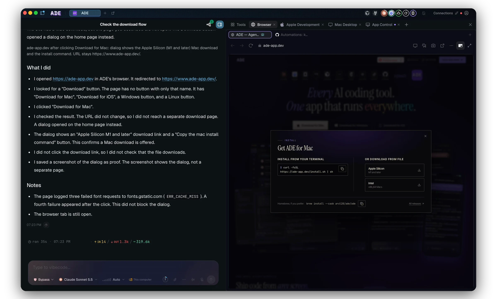

The **Browser** lives in the Work tab, right next to your chat. Open a web page beside the code that drives it, inspect an element, and hand exactly what you're looking at to an agent — no copy-pasting URLs or describing the bug in prose.

## Code and page, side by side

The browser opens on the Work right-edge sidebar, in the same surface as your agent chat — so the page you're testing and the agent fixing it share one screen. Change code in a lane, reload the page, and see the result without leaving ADE.

Unlike the lane-scoped tools, the browser belongs to the **ADE window**: each window owns its own tabs and active page, while all windows share one signed-in session, so a site you log into once stays logged in across them.

A local dev server with a self-signed HTTPS certificate can be trusted once per profile; the trust covers that address and that certificate only.

<Frame caption="The built-in browser beside the agent chat — inspect a page and hand it to the agent.">
  
</Frame>

## Inspect and hand off

Switch the pane into inspect mode and a DevTools-style outline tracks the element under your pointer. Click to commit it, and ADE captures the element — its markup, a stable selector, what's rendered, and a screenshot — then attaches it to the active chat as a context chip. Instead of "the button looks wrong," the agent gets the actual element it needs to fix.

## What it's for

<CardGroup cols={3}>
  <Card title="Verify a change" icon="circle-check">
    Reload the running app and confirm an agent's fix actually landed.
  </Card>
  <Card title="Capture context" icon="crosshairs">
    Select an element or page state and pass it straight into a chat.
  </Card>
  <Card title="Capture proof" icon="camera">
    Grab what you see as an artifact attached to the work.
  </Card>
</CardGroup>

<Tip>
Point the browser at a dev server started from a lane-scoped shell or agent session. The page and the process that serves it stay in the same lane, so a reload reflects the lane's latest code.
</Tip>

## Drive it from anywhere

The same browser is scriptable. The `ade browser` CLI surface lets an agent — or you — navigate, screenshot, inspect, and pick context from the shared tabs, so a chat agent can drive the page it's reasoning about.

- **Every agent sees every tab.** `ade browser status` lists every tab of the project on every machine ADE can reach, with its machine, its owner (by chat title and lane), who opened it, and where the next `open` will go.
- **One task stays on one machine.** ADE remembers which machine's browser holds each tab. A command that names a tab goes to that machine, a command without one goes where the chat's own tab is, and a plain `open` follows you. Errors name the machine that refused.
- **Isolated tabs open on your computer**, so you can see them.
- **Any agent can close any tab**, and `close` says whose tab it closed. Agents are told to check the owner first.
- **A project holds 20 tabs by default**; change it with **Tabs per project** in **Settings › Behaviour**. Archiving or deleting a lane frees its tabs without closing them. After a restart, tab ids and openers are kept, but an agent's tab comes back only if a person used it.

<CardGroup cols={2}>
  <Card title="Agent chat" icon="comments" href="/chat/overview">
    Hand browser context to an agent and let it work.
  </Card>
  <Card title="Computer use & proof" icon="camera" href="/computer-use/overview">
    Drive apps and capture evidence of what happened.
  </Card>
</CardGroup>
