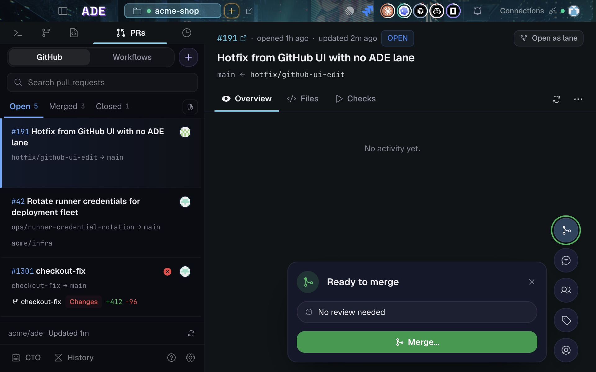

Every PR your agents open lands in Daex's **PRs** tab — the diff, CI checks, comments, and a merge button, without a GitHub browser tab. Daex keeps remote GitHub state warm through background polling while treating your local git state as the source of truth for merge and conflict simulation.

<Frame caption="The PRs tab: every pull request in the repo with its CI and review state.">
  
</Frame>

<Frame caption="PR management walkthrough on YouTube.">
  <iframe
    className="w-full aspect-video rounded-xl"
    src="https://www.youtube.com/embed/r3T8ePQyM6M"
    title="Daex PR management walkthrough"
    allow="accelerometer; autoplay; clipboard-write; encrypted-media; gyroscope; picture-in-picture; web-share"
    allowFullScreen
  ></iframe>
</Frame>

Watch the full walkthrough on [YouTube](https://youtu.be/r3T8ePQyM6M).

## Open a PR from a lane

Because every lane is its own branch, opening a PR is one step. Pick the lane, confirm the base branch, and Daex creates the PR — from the lane, from a chat, or straight from the PRs tab. The draft title and body are prefilled from the lane's commits and diff, and Daex returns both the GitHub URL and a Daex deep link so an agent can drop both into its closeout note.

<Note>
Branch names are validated before submission, so an invalid git ref fails in Daex with a clear message instead of an opaque GitHub API error.
</Note>

## Inspect the PR

The detail view splits a PR into focused tabs — **Overview**, **Files**, **CI / Checks**, and **Activity** — and each one loads on its own, so a slow comments fetch never holds up the checks or files.

The Overview renders as a **Timeline + Rails** layout: a central event timeline (commits, comments, reviews, label changes, merges, deployments), a left rail with the commit list and push-time checks, and a right rail with merge readiness, reviewers, labels, and participants.

You can reply to review threads, resolve them, react to comments, request reviewers, and submit your own review — approve, request changes, or comment — without leaving Daex.

The PRs tab lists every PR in the repository — including ones opened outside Daex — with filters for label, author, and assignee, CI badges, review indicators, and the linked lane's color, so a glance correlates a PR with the lane that produced it. Each PR's size is split into code, tests, and docs, so you can tell a large change from a large test suite.

## Merge it

When checks pass and reviews are in, merge from the readiness panel. Pick the method — **squash**, **merge**, or **rebase** — and land it.

<CardGroup cols={3}>
  <Card title="Auto-merge" icon="circle-play">
    Let the PR merge itself the moment it's green — useful for stacked work where each child waits on its parent.
  </Card>
  <Card title="Merge bypass" icon="shield-halved">
    When branch protection blocks a clean merge, opt in to retry with an admin merge. GitHub still decides whether the bypass is allowed.
  </Card>
  <Card title="Post-merge cleanup" icon="broom">
    Daex deletes the branch, archives the lane if configured, refreshes the base, and rescans rebase needs — all best-effort, so cleanup never undoes a good merge.
  </Card>
</CardGroup>

## Stacked PRs

For a GitHub stack, each lane has its own PR targeting the branch below it. Use `daex prs stacks` to inspect the stack; rebase a lane when its compare base advances.

<CardGroup cols={2}>
  <Card title="Dependency-ordered landing" icon="layer-group">
    Land a whole stack in one action: Daex merges the root, then each downstream PR in order, auto-rebasing any descendant that drifted and stopping on the first failure.
  </Card>
</CardGroup>

Each lane in the stack works on its own branch.

## Conflict simulation

Before you hit Merge, Daex predicts whether the PR lands cleanly on its base by running `git merge-tree` locally — no actual merge required. A predicted conflict disables the merge button (unless you opt into bypass) and surfaces the conflicting files. When updating a PR branch hits conflicts, Daex puts a resolve prompt in the lane's chat.

<Note>
Daex uses your GitHub authentication. If PR data is missing, check GitHub access in Settings.
</Note>

<CardGroup cols={2}>
  <Card title="History" icon="clock-rotate-left" href="/tools/history">
    Inspect the commits, chats, and agent work behind a pull request.
  </Card>
  <Card title="Conflicts" icon="code-merge" href="/tools/conflicts">
    Detection, simulation, and AI-assisted resolution across lanes and PRs.
  </Card>
</CardGroup>
